# SmartOS

*[อ่านฉบับภาษาไทย](README.th.md)*

A custom OS for the ESP32-S3, built from the kernel upwards.

> The stage-by-stage record below was written while this was called Project
> S3, and it still says so in places. The code was renamed in one go late on
> (see `R3` in the history); the record was left as it was written, because
> rewriting it would make it a worse record.

The kernel does not sit on top of FreeRTOS - it owns core 1 outright. IDF is
built unicore, so FreeRTOS never starts the second core, and the kernel takes
it: its own vector table, its own timer interrupt, its own scheduler, its own
allocator. Core 0 stays behind to run USB, flash and PSRAM, and to take jobs
handed to it over a mailbox.

```
 CORE 0                          CORE 1
 IDF + FreeRTOS                  SmartOS
  - USB console                   - vector table   (kvectors.S)
  - flash / PSRAM                 - CCOMPARE0 tick (ktime.cpp)
  - mailbox worker                - scheduler      (ksched.cpp)
                                  - context switch (kswitch.S)
                                  - allocator      (kheap.cpp)
        ^                                |
        +------- kmbox job slots --------+
```

## Hardware

| part | detail |
|---|---|
| MCU | ESP32-S3-DevKitC-1 **N16R8** - 16 MB QIO flash, 8 MB octal PSRAM |
| Display | **2.4" 240x320 SPI TFT, ST7789V** - driven landscape, 320x240 |
| Touch | XPT2046 on the same SPI bus (unused so far) |
| Note | the module's SDO never reaches the controller, so the panel cannot be identified by reading it - `-D LCD_FORCE_CTRL` names it instead |
| Input | 6 buttons to GND, read with internal pull-ups |

Wiring lives in [src/board/pins.h](src/board/devkitc_n16r8.h). **GPIO 26-37 are off limits**
on this module - they belong to the octal flash and PSRAM.

**The buttons are two wires each**: one side to the GPIO, the other to GND,
and nothing else - the chip's internal pull-ups are on, so a pressed button
reads 0 and no resistor is needed. UP 4, DOWN 5, LEFT 6, RIGHT 7, OK 15,
BACK 16, which sit next to each other on one header. On a tactile switch use
the diagonal pins: the two on the same side are already joined inside, and
wiring those is the same as holding the button down for good.

Nothing has to be wired to try it. `key up`, `hold back` and `min` in the
serial shell publish the same events the button sampler does, which is how
every test in here drives the interface.

Built for one board, but written to be taken further:
[CONTRIBUTING.md](CONTRIBUTING.md) is how to build it, what the rules on core 1
are, and how to add an app or a test ([ฉบับภาษาไทย](CONTRIBUTING.th.md)).
[MIT licensed](LICENSE), with an unofficial Thai translation in the same file.

## What is in here

```
components/smartos/       the kernel, and what it stands on. Its own ESP-IDF
                component, so its REQUIRES list is a machine-checked claim
                about what it depends on - and examples/kernel_blink builds
                against it alone.
  kernel/       scheduler, context switch, allocator, mailbox, timer, locks,
                the fault reporter. No ESP-IDF headers at all   (3,800 lines)
  arch/xtensa/  the vector table, the context switch, compare-and-swap, the
                interrupt mask. Replaced on a port to another architecture
  port/         this chip: starting core 1, the inter-processor interrupt
                that parks it, the console, the heap carve at boot
include/        smartos.h for a program on the kernel, smartos_app.h for an
                app on the OS, smartos_config.h for every setting
src/os/         services the apps are built on: event bus, app model, files,
                settings, system log, shell, screen, radio   (4,700 lines)
src/gfx/        framebuffer, damage tracking, 5x8 font, pictures
src/board/      the board: SPI panel, buttons, console
src/ui/         what every app's screen is made of: lists, bars, confirmation,
                the on-screen keyboard
src/apps/       the apps, one file each - drop a file in, it registers itself
src/tests/      every claim in this README, as code that runs on the board
                                                             (3,200 lines)
examples/       kernel_blink/ is a separate project that builds against the
                kernel component and nothing else - the proof that the layers
                really do come apart. See examples/README.md
tools/          the host side: shell driver, screenshots, picture converter,
                font generator, Wi-Fi survey                   (860 lines)
docs/screens/   screenshots taken through tools/screenshot.py
docs/radio/     Wi-Fi surveys - the measurements behind stage 6.3
docs/art/       the wallpaper's source picture
docs/prototype_arduino/   where this started, before stage 2.0 moved it off
                the Arduino core onto bare ESP-IDF
```

Two files are generated and committed because the build needs them:
`src/gfx/wallpaper_data.cpp` (from `docs/art/`, by `tools/mkimage.py`) and
`src/gfx/font5x8.h` (from `tools/font5x8.txt`, by `tools/gen_font.py`).

## Writing for SmartOS

Two different jobs, and the system now makes the difference explicit. There is
a worked example of each in **[examples/](examples/)**.

| | a program on the kernel | an app on the OS |
|---|---|---|
| include | `smartos.h` | `smartos_app.h` |
| you get | tasks, mutexes, semaphores, queues, the clock, the heap, `klog` | all of that, plus the screen, events, files, settings, the log, the toolkit, the buttons |
| lives in | its own project, pointed at `components/smartos` | one file dropped in `src/apps/` |
| started by | its own `app_main` | the user, from Home |
| example | [examples/kernel_blink/](examples/kernel_blink/) — 175 KB of flash, 17 KB of RAM | [src/apps/app_hello.cpp](src/apps/app_hello.cpp) — copy it |

`examples/kernel_blink` is a separate PlatformIO project that builds against
the kernel component and three ESP-IDF components, with no part of the
operating system in it at all. That it links and runs is the reason the layers
are arranged the way they are.

Every setting the system has is one file, **[include/smartos_config.h](include/smartos_config.h)**:
eighteen sections, every entry wrapped in `#ifndef` so a project can override
it from `build_flags` without editing the file, and every number that was
chosen by measurement carries the measurement with it. A running board will
tell you what it was built with - the first four lines after the hardware are
the configuration it actually has.

## Porting it

The parts that would change are separated, and the separation is enforced by
the build rather than asserted here:

| | holds | replaced when |
|---|---|---|
| `components/smartos/kernel/` | scheduler, locks, heap, clock, mailbox, faults | never - it has no ESP-IDF or chip headers at all |
| `components/smartos/arch/xtensa/` | vector table, context switch, compare-and-swap, interrupt mask | moving to a different instruction set |
| `components/smartos/port/` | starting core 1, the inter-processor interrupt, the console, the heap carve | moving to a different chip |

The component's `REQUIRES` list in
[components/smartos/CMakeLists.txt](components/smartos/CMakeLists.txt) is the
dependency claim, and CMake enforces it: seven ESP-IDF components, all of them
reached from `port/`. A kernel file that reaches for anything else stops the
build.

What a port has to provide is the handful of functions in
[components/smartos/port/kport.h](components/smartos/port/kport.h) - placing
code in RAM, a console, a microsecond delay, the core id, an inter-processor
interrupt, and a one-off heap carve at boot - plus starting the second core.
It is deliberately inline functions and link-time symbols rather than a table
of function pointers: the context switch and the spinlocks are measured in
instructions, so everything on those paths has to resolve at compile time.

## Build

```
pio run -t upload -t monitor
```

That is the whole of it on a fresh clone: PlatformIO fetches ESP-IDF and, from
[src/idf_component.yml](src/idf_component.yml), the one third-party component
this uses - littlefs, pinned by `dependencies.lock` to the version everything
here was measured against. `managed_components/` is not in the repository
because that file is what restores it.

**The board checks itself at every boot** and prints the result over USB, so
`-t monitor` is not optional reading: 48 cases on an ordinary boot, and with
`-D SMARTOS_TEST_APPS` in `build_flags`, 132. `python tools/boot_check.py` resets
the board, counts them for you and compares the case names against a committed
baseline, so a test that quietly stops running is noticed. The other test
builds - the kernel under load, a full filesystem, an app that never yields -
are listed with what each one must print at the bottom of
[platformio.ini](platformio.ini).

> **A correction.** The stage-by-stage record below quotes higher figures -
> 51 and 134, and later 51 and 135. Those came from counting every line of
> the boot log that ends in `OK`, and three of those lines are not tests:
> ESP-IDF's own `SPI SRAM memory test OK`, and the `[consumer]` and `[mbox]`
> demo tasks reporting their own sums. Nothing regressed; the count was
> wrong, not the firmware. The per-stage numbers are left as they were
> written, because that is what was measured at the time.

The host-side tools in [tools/](tools/) talk to the board over the same USB
connection: `shell_test.py` drives the shell through its whole command set,
`screenshot.py` saves what is on the panel as a PNG, `wifi_survey.py` measures
what the radio hears.

Two environment constraints, both learned the hard way:

* **No spaces anywhere in the project path.** ESP-IDF's build system rejects
  them outright, which is why this folder is `Project_S3`.
* **Our HAL is `src/board/`, not `src/hal/`.** IDF ships its own
  `hal/log.h`, and a quoted include from inside a directory called `hal`
  finds IDF's copy instead of ours. See the note in [src/CMakeLists.txt](src/CMakeLists.txt).

## Stages

| stage | contents | state |
|---|---|---|
| 1 | hardware bring-up: memory check, panel ID, frame-rate benchmark, button test | **verified on hardware** |
| 2.0 | move from the Arduino core to bare ESP-IDF, unicore | **verified on hardware** |
| 2.1 | wake core 1 and run our code on it | **verified on hardware** |
| 2.2 | our own vector table and fault recorder for core 1 | **verified on hardware** |
| 2.3 | TCB, per-CPU scheduler, Xtensa context switch | **verified on hardware** |
| 2.4 | CCOMPARE0 tick, `k_sleep_ms`, deferred rescheduling | **verified on hardware** |
| 2.4b | **full preemption** - the tick switches tasks from inside the ISR | **verified on hardware** |
| 2.5 | the kernel's own allocator; task stacks come from it | **verified on hardware** |
| 2.6a | core 0 as a service processor, over a lock-free mailbox | **verified on hardware** |
| 2.6b | full SMP - the kernel scheduling both cores | **verified on hardware** |
| 2.7 | blocking mutex / semaphore / queue, priorities, stack guard | **verified on hardware** |
| 3.1 | SPI transfers off the CPU: queued + interrupt instead of polling | **verified on hardware** |
| 3.2 | framebuffer in PSRAM, clipped draw primitives, panel brought up correctly | **verified on hardware** |
| 3.3 | damage tracking: flush only the rectangles that changed | **verified on hardware** |
| 3.4 | one SPI transaction per rectangle, double-buffered staging | **verified on hardware** |
| 3.5 | 5x8 bitmap font, `fb_text` / `fb_text_bg`, one damage region per call | **verified on hardware** |
| 3.6 | buttons as an event stream: core 1 sampler, `k_queue`, core 0 consumer | debouncer **verified by script**; live presses awaiting a hands-on check |
| -O2 | build moved off -Og; stage 2 tests re-run; SMP sleep-claim race found and fixed | **verified on hardware** |
| 4 | OS services: event bus, app model, filesystem, settings, system log | **4.1-4.5 done** - see the Stage 4 table |
| 5 | userland - planned as below | **done** (5.1-5.5) |

Stage 5, planned (order 5.1, 5.2, 5.3, 5.5, 5.4):

| stage | contents | state |
|---|---|---|
| 5.1 | serial shell over USB: `ps`, `free`, `df`, `log`, `ls`/`cat`, `open`/`close`, `set`, `key`/`hold` (inject button events), `reboot` | **verified on hardware** |
| 5.2 | `k_task_kill`: force-close an app that never yields, and clean up after it (subscription, timers, streams, heap, an in-flight mailbox call into its stack); hold BACK kills after 2 s; shell `kill` | **verified on hardware** |
| 5.3 | task manager app and per-task CPU accounting (busy/idle/parked); `ps` with CPU; round robin fixed per priority level | **verified on hardware** |
| 5.3b | Tasks: a Performance page after the Windows Task Manager (CPU, memory, flash, 60 s graphs); shell `screenshot` + `tools/screenshot.py` | **verified on hardware** |
| 5.3c | memory: ended tasks' stacks returned at once; kernel pool 128 KB internal + 4 MB PSRAM for apps (`app_alloc`, freed when the app ends); Kernel/RAM/PSRAM pages with composition bars | **verified on hardware** |
| 5.5 | minimise: DOWN + BACK puts the app in the background, still running; Home lists it under "Running"; `app_can_start` refuses an app that would not fit (slots, kernel memory, declared PSRAM) | **verified on hardware** |
| 5.4 | launcher polish: app descriptions, storage and uptime in the status bar, "OK again" before clearing the log, screen-off timeout that wakes on a swallowed press | **verified on hardware** |
| 5.4b | housekeeping: the test suites split out of main.cpp into `src/tests/`, one file per area | **verified on hardware** |
| 5.4c | one UI toolkit for the apps' screens (`src/ui/`): lists, scrolling, value bars, "press it again" | **verified on hardware** |
| 5.4d | the limits, on purpose: a stack per app, timers and bus slots running out, a full filesystem | **verified on hardware** |
| 5.4e | no frames sent while the screen is off; a per-app ceiling on kernel memory | **verified on hardware** |

Stage 6, how the system looks (the user's list, in order):

| stage | contents | state |
|---|---|---|
| 6.1 | a boot screen: the panel stays dark through the self-tests, then a mark, the name and a spinner | **verified on hardware** |
| 6.2 | a background image on Home: `tools/mkimage.py`, RGB565 in flash, blended selection, shadowed text, a setting to turn it off | **verified on hardware** |
| 6.3 | the radio: what the chip can do, the channel plan, a scan, and a survey tool to compare antennas | **verified on hardware** |
| 6.4a | a keyboard for six buttons (`src/ui/keyboard.h`) and the notes app that uses it | **verified on hardware** |
| 6.4b | ~~an app that reaches the web~~ | cancelled by the user |
| 6.4c | external keyboard and mouse - USB host or BLE HID, and a hardware decision to make | not started |

### What the board actually did

```
core 1    : asleep, never started by IDF
[core1] vector table is ours, faults are recorded not silent
[kernel] tick armed: 1000 Hz, 240000 cycles, CPU int 6 (CCOMPARE0)
[alpha] i=0  sp=0x3fc97070      <- separate stacks, interleaved by the scheduler
[beta]  i=0  sp=0x3fc98080
[deep] round 0: yielded from 6 frames deep, all intact
[heap] reallocated 2048 -> 0x3fc9d560 (reused the hole)
[core1 via core0] printed with a real printf, by the other core
[mbox] core 0 summed 16 squares -> 1240 (expected 1240) OK
[ticker] tick=25 / 50 / 75 / 100 / 125 ms
[core0] core 1 tick counter: 818 -> 918 over 100 ms
```

100 ticks in 100 ms - the kernel's clock is exactly 1000 Hz. 29 context
switches with no corruption. Deepest stack use across seven tasks was 592 bytes
of the 4096 each is given, so `K_STACK_SIZE` has plenty of room to come down.

### Preemption

A task that never yields no longer owns the core. The demo's `hog` spins for
200 ms without a single `k_yield`, and the ticker keeps printing straight
through it:

```
[hog] spinning for 200 ms and never yielding - watch the ticker
[ticker] tick=25 / 50 / 75 / 100 / 125 / 150 / 175 / 200 ms
[hog] done: 2059920 iterations, and I never once gave up the core
  core 1: 80 switches, 200 tick-driven scheduling points (preempt on)
```

Under the cooperative scheduler the same demo printed nothing from the ticker
until tick 202, after the hog had finished. Three runs back to back, no faults.

The interrupt entry ([kernel/kvectors.S](components/smartos/arch/xtensa/kvectors.S)) leaves
exception mode, saves all sixteen address registers plus SAR and the loop
registers, and calls C on the interrupted task's own stack. That last choice is
what makes it simple: `k_yield()` from inside the interrupt is an ordinary call,
and when the task is scheduled again it returns straight back into the exit path
and `rfe`s to where it was.

### SMP

One scheduler, one ready queue, both cores pulling from it:

```
  id name        state  cpu aff  switches
   6 hog         DEAD    0   *           8
   8 cpu0idle    READY   0   0          33
   9 smpA        READY   1   *         129
  10 smpB        RUN     0   *         140
  core 0: 70 switches
  core 1: 396 switches
[smpA] 85 rounds on core 0, 115 on core 1
[smpB] 87 rounds on core 0, 113 on core 1
```

The same task runs on either core from one round to the next, and the split
moves around between runs (15/185, 89/111, 77/123 across three) exactly as two
cores racing for the same queue should. A task is claimed by being moved out of
`K_READY` under the scheduler spinlock, which is what stops both cores walking
off with the same one.

**Core 0 is borrowed, not taken.** It still owes FreeRTOS the USB console, the
flash driver and the mailbox worker, so instead of seizing it outright the
kernel enters through a FreeRTOS task (`k_smp_join`) and keeps one task pinned
there - `cpu0idle` - whose whole job is to hand the slice back with
`vTaskDelay` and then ask for it again. WiFi, flash and the console all survive.

The honest limits of that trade: the kernel does not preempt on core 0. Our tick
interrupt lives on core 1's vector table, so tasks running on core 0 are
preempted by FreeRTOS instead and reach our scheduler when they yield. Tasks are
also `K_CPU_ANY` by default; `k_task_create_on` pins one to a core when that
matters.

### Synchronisation

The kernel had no way for its own tasks to talk to each other until this stage -
only shared variables and hope. The spinlock in `kspin.h` is not a substitute:
spinning is right for the few instructions of a scheduler critical section and
completely wrong for one task waiting on another. These block instead, moving
the task to `K_BLOCKED` so the scheduler stops picking it.

```
[consumer] received 50 items, sum 1275 (expected 1275) OK
[muxA] done, counter now 200
[muxB] done, counter now 400
```

The mutex result is the one that means something. Two tasks, both cores,
preemption on, each adding to the same counter 200 times - with a `k_yield()`
deliberately placed *inside* the read-modify-write, so the lock has to hold
across a context switch rather than merely across an instruction. 400 exactly,
on every run. The queue is smaller than the message count on purpose, so both
the send-blocks-on-full and receive-blocks-on-empty paths get used.

Wait lists are one `uint16_t` per object, one bit per task - which is also why
`K_MAX_TASKS` is 16 and not a round number.

Priorities are lower-number-wins, with round-robin surviving inside each level.
One placement is worth knowing about: `cpu0idle` is at NORMAL, not at an idle
priority, because it is the only thing handing core 0 back to FreeRTOS. Starving
it would take the USB console and the flash driver with it.

### Three bugs the hardware found that review had not

1. **The tick ISR was writing into the interrupted frame's base save area.**
   The sixteen bytes below any Xtensa stack pointer belong to the window
   overflow handler. Scribbling there corrupted registers that were reloaded
   much later, and the failure surfaced as a double exception inside the ROM
   printf - nowhere near the cause. Fixed by reserving 32 bytes instead of 16.
2. **Both cores were writing the console with no arbitration.** `esp_rom_printf`
   on core 1 and `printf` on core 0 push at the same USB-serial-JTAG FIFO. Fixed
   with a real cross-core spinlock built on `S32C1I` ([kernel/kspin.h](components/smartos/kernel/kspin.h)).
3. **`k_exit` halted the core while tasks were still sleeping.** "Nothing is
   READY" is not "nothing is left" - a sleeper becomes runnable when the tick
   says so. Fixed by idling in `waiti` while any task is still asleep.

### Four more the hardware found while bringing up preemption

1. **Only a0-a3 were saved.** The register window does not protect a4-a15
   across a `call4`: `ENTRY` rotates WINDOWBASE, so the callee sees them as its
   own a0-a11. It showed up as an argument to `esp_rom_printf` arriving as
   garbage.
2. **The base save area did not move with the stack pointer.** Dropping `a1` to
   carve an interrupt frame orphaned the sixteen bytes below the old SP - and
   the call8/call12 overflow handlers *read* the caller's SP back out of
   `[sp-12]` to decide where to spill a4-a7. It has to be copied down on entry.
3. **...and copied back on exit.** While `a1` pointed at the interrupt frame,
   every overflow wrote to the copy; the moment `a1` went back, the matching
   underflow read from the original. Reconciling only one direction turned a
   plain `retw` in `k_ticks()` into a stack pointer made of code addresses.
4. **Preemption inside the ROM printf.** Every early failure had the
   interrupted PC inside ROM. `klog` now holds the scheduler off for the length
   of a line - which also stops two tasks interleaving their output.

### And one that was not a bug at all

The first SMP runs had every task on core 1 and none on core 0, which looked
like a scheduler fault. It was not: the demo's tasks either slept or were the
single running task, so at the instant core 0 asked for work the ready queue was
genuinely empty. Two cores only visibly share work when there is work sitting
there to be shared - the SMP tasks had to be made CPU-bound and long enough to
span hundreds of milliseconds before anything interesting happened.

### Two more from the SMP and IPC work

1. **`k_preempt_hold` was global.** Fine on one core, wrong on two: `klog()` on
   core 0 raised it and quietly stopped core 1 being preempted for the length of
   a line printed by the other core entirely. A critical section belongs to the
   core that entered it, so it moved into `k_percpu_t`.
2. **`logln` never took the console lock** - only `logf` did - and the lock's
   10 ms timeout was too short anyway, because it is held across a `printf` that
   blocks until the USB FIFO drains. Two cores printing produced interleaved
   characters until both were fixed.

### The stack guard, and what it took to make the test honest

Every stack has a 256-byte run-off area below it, and the word immediately under
the usable stack is checked on every switch-out - one compare per switch. With
`-D SMARTOS_TEST_STACK_OVERFLOW`:

```
[overflow] overrunning a 2048 byte stack on purpose
  11 overflow    DEAD    1   *   8     2     2048/ 2048
  !! task 11 overran its stack (it kept running - the run-off
     area below it absorbed the damage, but its stack is too small)
```

Getting there took three corrections, and none of them were in the guard:

1. **No run-off area at all.** The overrun went straight into the neighbouring
   task's stack - they all come from the same heap - and the board boot-looped
   on an interrupt watchdog before the guard could say anything.
2. **The run-off area was there but the test overran by too much.** A task that
   has overrun still has to be switched out, and switching writes about 200
   bytes *below* the stack pointer: a base save area per live window, k_yield's
   frames, and the 112-byte interrupt frame if the tick lands there. Ten bytes
   of headroom meant the switch itself wrote past the allocation into the next
   heap block's header, the heap chain looped, and core 0 wedged. That is also
   why `K_STACK_GUARD` is 256 and not 64.
3. **The test only wrote both ends of its oversized array.** The guard word sits
   four bytes below the usable stack, which the two ends happened to miss, so
   the first clean run reported nothing at all.

The guard detects, it does not protect - a task that overruns keeps running on a
stack that is too small. What it buys is that the failure has a name and a task
id instead of being a lockup somewhere else entirely.

Also checked statically, from the ELF: `k_vector_table` (named `s3_vector_table` until R3a) is 1 KB aligned
(VECBASE requires it) with all fifteen vectors on their exact offsets, and every
function and variable core 1 touches is in IRAM/DRAM, never flash.

### Stage 3.1 - getting the CPU out of the transfer

```
frame is 320x240 at 2 bytes/pixel = 153600 bytes on the wire
  polling   20.09 ms/frame   49.8 FPS  7.65 MB/s   other work done: 0
  queued    22.64 ms/frame   44.2 FPS  6.78 MB/s   other work done: 1363646
```

Wall-clock frame time cannot tell the two apart on its own - the same bytes go
out at the same clock either way. What changes is whether the core is available
while they do, so the benchmark runs a counting task pinned below it and reports
how much of it got done. Polling: nothing. Queued: 1.36 million iterations. The
core goes from fully consumed to essentially free.

The price is 2.55 ms a frame, and it is worth understanding rather than
accepting: the fills go out row by row, 240 transactions per frame, and moving
from a busy-wait to an interrupt plus a semaphore costs about 10.6 us on each
one. 240 x 10.6 us = 2.54 ms, which is the difference to within a rounding
error.

That also says what stage 3.4 is worth. Pushing a rectangle as one transaction
instead of one per row pays that cost once rather than 240 times: a full-frame
flush should come out near 15.4 ms - 65 FPS - and be free to the CPU besides.
`max_transfer_sz` has to come up from 4096 first.

> **Stage 3.4 revisited both of these.** The prediction held: a full frame came
> out at 15.99 ms and 62.5 FPS. The 10.6 us per-row penalty was real arithmetic
> about a real cost, but the framing was incomplete - it was not the price of
> queued mode, it was the price of using a four-deep queue *synchronously*, one
> row at a time, which is what `lcd_data()` was doing. Once transfers actually
> overlap, queued matches polling to within 0.02 ms and still leaves the core
> free. The numbers in this section are the pre-3.4 driver; see stage 3.4 for
> what the same benchmark reads now.

The boot order changed to make the measurement honest: the display is brought
up and benchmarked before `wake_core1()`, because once the kernel joins core 0
the benchmark is sharing it with whatever the scheduler puts there.

### Stage 3.2 - the framebuffer, and what the panel actually wanted

```
  clear (memset path) :   4.02 ms   38.2 MB/s
  clear (pixel loop)  :   4.40 ms   34.9 MB/s   <- the real cost
  fill 200x120        :   1.55 ms
  present, staged     :  25.64 ms   39.0 FPS
  present, DMA from PSRAM:  26.84 ms   37.3 FPS
```

The question this stage had to answer was whether moving the framebuffer
off-chip just moves the bottleneck. It does not: a full-screen fill in PSRAM
costs 4.4 ms against 20 ms to send the same frame, so the compositor will be
waiting on the panel, not on memory. memset and the pixel loop are within 9% of
each other, which says the limit is PSRAM bandwidth rather than the CPU - there
is nothing to win by writing a cleverer fill.

Asking the DMA engine to read PSRAM directly works but is slightly *slower*
than staging through internal RAM, presumably because the staging copy overlaps
with the transfer already in flight while direct reads contend for the PSRAM
bus. That closes a question stage 3.4 would otherwise have had to ask.

> **Stage 3.4 asked it again anyway**, because the obvious objection to the
> result above was that a one-row transaction is too small for the difference to
> mean anything. With chunks thousands of bytes long the answer was the same -
> 18.77 ms direct against 15.97 staged - so it is settled rather than assumed.
> The present timings here are the pre-3.4 driver: staged is now 16.10 ms.

**Pixels are stored in the panel's byte order, not the CPU's.** A frame is
76,800 pixels; swapping each one on the way out is 76,800 swaps on the critical
path, every frame. Storing them pre-swapped moves that to `fb_rgb()`, which runs
once per *colour* - a ten-thousand-pixel fill swaps once. The cost is that a
value in `fb->px` is not a normal RGB565 number, which the header says loudly.

#### Two panel settings, found the hard way

The first self-test came back with a white background and every colour its
complement *and* the corners swapped left for right. Both at once, which is why
the earlier demo scene could not diagnose it - eight colour swatches in a row
look much the same mirrored, and no single explanation fit.

1. **Inversion.** Most ST7789 boards want `0x21` (INVON) and this one wants
   `0x20`. With it wrong, black is white and every colour is its complement.
2. **`MX` and `MY` mirror the panel's own axes, and `MV` exchanges them
   afterwards.** So with `MV` set, the bit that flips what the viewer sees as
   horizontal is `MY`, not `MX`. Reaching for the intuitive one turned a
   left-right mirror into a 180 degree rotation - the same mistake twice, not a
   new symptom. Landscape is `0xA0` = `MV | MY`.

The test that settled it is kept as `-D SMARTOS_GFX_SELFTEST`: a different colour in
each corner and a wide bar across the middle, so inversion, colour order and
rotation each fail in their own distinguishable way.

### Stage 3.3 - sending only what changed

A full frame costs 25 ms. Almost nothing an interface does is a full frame, so
the compositor tracks which rectangles changed and flushes those instead.

```
  cursor       40x20       1600 bytes    0.97 ms    1.6 MB/s   1026.7 FPS-equivalent
  button      100x40       8000 bytes    2.27 ms    3.5 MB/s    441.1 FPS-equivalent
  status bar  320x24      15360 bytes    2.65 ms    5.8 MB/s    377.2 FPS-equivalent
  half screen 320x120     76800 bytes   12.48 ms    6.2 MB/s     80.1 FPS-equivalent
  whole frame 320x240    153600 bytes   25.25 ms    6.1 MB/s     39.6 FPS-equivalent
```

A moving 40x20 box on a static background, 150 frames:

```
  regions per frame      : 1.00 average, 1 worst
  pixels sent            : 129000  (full frames would be 11520000)
  work per frame         :   0.95 ms ->  1048.0 FPS
  same frames, full push :  25.25 ms ->    39.6 FPS
  speed-up               : 26.5x, sending 1.12% of the pixels
```

The erase and the redraw overlap at a 3 px step, so they merge and the average
comes out at one transfer per frame rather than two.

The bandwidth column is the interesting one. It falls off badly for small
rectangles - 1.6 MB/s for the cursor against 6.1 for the whole frame - because
the blit is still **one SPI transaction per row**. Dividing through: a 40x20
flush spends 49 us per row to move 8 us of pixels, and a full-screen flush 105
us per row to move 64. Both give the same answer, about **41 us of fixed
overhead per transaction**, which is what stage 3.4 exists to remove.

So the win here is real but not yet complete: 26.5x from sending less, with
another factor waiting in sending it in fewer pieces.

#### The merge rule, and the mistake in the first one

The damage list is eight fixed slots in `fb_t` - fixed because the draw path
must never touch the allocator. New rectangles merge into existing ones when
that is cheaper than a second transfer; when all eight are full, the new one is
merged into whichever existing region grows least. That last case costs pixels,
never correctness: a union always covers the real damage.

The first version of `should_merge` forced a merge whenever two rectangles
overlapped, reasoning that the overlap would otherwise be sent twice. It would -
but the bytes are read out of the framebuffer at flush time, so both copies are
identical and the panel cannot tell. Overlap costs time and nothing else.

What that rule did cost was the commonest shape in an interface. A box outline
is four thin rectangles, and its top edge and left edge share exactly one corner
pixel - so the merge was mandatory, and four lines totalling 638 pixels became
their bounding box of 24,000. A 37x pessimisation in the case that matters most.

The fix was to delete the special case. It is arithmetic only now: merge when
the union adds fewer than 128 pixels - one transaction's 41 us buys about 125 at
the measured rate - or when it inflates the transfer by less than a quarter.
Overlap needs no rule of its own, because overlapping rectangles have a union
smaller than the sum of their areas, so the waste is negative and the first test
merges them anyway. The right answer, for the right reason.

#### The test that found it

`damage_logic_test()` runs the tracker with no panel attached and checks five
cases, each chosen because it fails differently:

```
  overlapping             2 in -> 1 regions (want 1)    4800 px touched,   4500 sent  OK
  edge to edge            2 in -> 1 regions (want 1)    4800 px touched,   4800 sent  OK
  opposite corners        2 in -> 2 regions (want 2)    1600 px touched,   1600 sent  OK
  box outline, 4 sides    4 in -> 4 regions (want 4)     640 px touched,    640 sent  OK
  12 into 8 slots        12 in -> 7 regions (want <=8)  4800 px touched,   8800 sent  OK
```

Every case also asserts the invariant that actually matters: **every rectangle
ever marked is still fully contained in some region**. A region list that fails
that leaves stale pixels on the glass, which presents as "the screen is
sometimes wrong" and is miserable to chase later. Counting regions is how the
efficiency is judged; containment is how the correctness is.

The overflow case comes out at 7 rather than 8 because `coalesce()` runs after a
forced merge and the grown region can then absorb another - fewer than the cap
is fine, more is not, so the check is an upper bound.

### Stage 3.4 - one transaction per rectangle

Rows were never the panel's idea. `CASET`/`RASET` set an address window once and
everything after `RAMWR` pours into it as a continuous stream, wrapping to the
next row by itself. Sending one SPI transaction per row was the driver's habit,
and it cost about 41 us each - 9.8 ms of a 25 ms frame spent on nothing.

So the stream is cut into chunks of whole rows instead, as many as fit in an
8 KB staging buffer. A full frame goes from 240 transactions to 20.

```
                                            3.4      3.3
  cursor       40x20    1600 bytes     0.38 ms   0.97   2.6x    4.3 MB/s
  button      100x40    8000 bytes     1.11 ms   2.27   2.0x    7.2 MB/s
  status bar  320x24   15360 bytes     1.85 ms   2.65   1.4x    8.3 MB/s
  half screen 320x120  76800 bytes     8.03 ms  12.48   1.6x    9.6 MB/s
  whole frame 320x240 153600 bytes    15.99 ms  25.25   1.6x    9.6 MB/s
```

The moving-box frame from stage 3.3 went from 0.95 ms to **0.40 ms**, which is
40x a full push rather than 26x.

**The frame is now within 0.61 ms of the wire.** 153,600 bytes at 80 MHz is
15.36 ms and the measurement is 15.99 - about 96% of the link's theoretical
throughput actually carrying pixels. There is no second factor of two hiding
here; the panel is the limit now, and the only way past it is a faster bus.

#### The second staging buffer

```
  full frame, polling (no overlap possible) :  18.55 ms   53.9 FPS
  full frame, queued  (copy under transfer) :  15.97 ms   62.6 FPS
  full frame, DMA straight from PSRAM       :  18.77 ms   53.3 FPS
  153600 bytes at 80 MHz                    :  15.36 ms  <- the floor
```

Staging is a memcpy out of PSRAM at ~38 MB/s while the wire takes bytes at ~10.
With one buffer those alternate - copy, wait, copy, wait. With two, the copy for
chunk N+1 runs while chunk N is still going out. Polling cannot overlap by
construction, so running the same frame both ways prices the overlap exactly:
**2.58 ms**, which is about what 153,600 bytes of PSMRAM read should cost. The
memcpy has disappeared under the transfer.

The ordering rule that makes it correct is to **reap before filling, never
before sending**: a staging buffer is safe to write only once the DMA engine has
finished reading it, which is what `lcd_bus_wait_one()` establishes. That is why
the bus layer grew a way to reap exactly one completion - the blit needs to know
that one specific buffer is free, not that the bus has gone idle.

Asking the DMA engine to read PSRAM directly is still slower (18.77 against
15.97) even now that a transaction is thousands of bytes rather than one row.
Stage 3.2 found the same thing per-row and the obvious objection was that the
transactions were too small for it to matter. They are not small any more and
the answer did not change, so the question is closed: **staging through internal
RAM wins, and it wins because the copy is free while the wire is busy.**

#### What this fixed in stage 3.1's numbers

The queued path used to be *slower* than polling - 22.64 ms against 20.09 - and
the write-up put that down to a 10.6 us per-transaction penalty times 240 rows.
That was the right arithmetic about the wrong design. `lcd_data()` in queued
mode called `lcd_data_async()` and then `lcd_bus_wait()` immediately, so the
four-deep queue was never once used: every row was synchronous, and queued mode
paid the interrupt's cost for none of its benefit.

With chunks the same benchmark reads:

```
  polling   15.89 ms/frame   62.9 FPS  9.67 MB/s   other work done: 0
  queued    15.87 ms/frame   63.0 FPS  9.68 MB/s   other work done: 1595249
```

Identical wall-clock time, and one of them leaves the core free for a million
and a half iterations of something else. That is what stage 3.1 was supposed to
demonstrate and could not, because the driver underneath it was not yet using
what the queue offered.

#### The new floor, and what it is made of

```
  address window (CASET+RASET+RAMWR) :  117.2 us, whatever the size
  transactions per full frame        : 240 -> 20  (12 rows each)
  a 40x20 cursor is 1600 bytes = 160 us on the wire at 80 MHz
```

A cursor-sized flush is now 0.38 ms, of which 117 us is setting the address
window and 160 us is pixels. The window setup is five *polling* transactions
carrying eleven bytes between them, and it costs more than a third of a small
flush. The bottleneck for small rectangles has moved from the pixel path to the
command path - worth knowing before anyone tries to make small flushes faster by
sending fewer pixels, which is now the part that is already cheap.

`lcd_fill_rect` is chunked the same way, with one difference: every chunk is the
same bytes, so it needs no second buffer. Several transfers may point at the one
staging buffer at once because nothing is going to rewrite it underneath them.

### Stage 3.5 - text

A 5x8 bitmap font drawn in a 6x10 cell and scaled by whole numbers: 53 columns
by 24 lines at scale 1, 26 by 12 at scale 2. API in `src/gfx/text.h`:
`fb_text` (ink only, for text over a picture), `fb_text_bg` (paints the whole
cell, for anything rewritten in place), `fb_text_width` / `fb_text_height`.

#### The font is pictures, not hex

The glyphs were drawn from scratch for this project, so there's no licence to
track. They live in `tools/font5x8.txt` as ASCII art, one 5x8 block per
character, and `python tools/gen_font.py` turns them into `src/gfx/font5x8.h`.
The header is output and says so. 95 glyphs as 760 hex bytes can't be reviewed
by eye; 95 pictures can, and `--preview TEXT` prints any string the way the
panel will draw it.

The generator does more than parse. It fails on anything that would compile
but draw a wrong letter: a row that isn't exactly five of `#`/`.`, a missing or
duplicated character, a blank glyph, and ink on the descender row (row 7) in
anything other than `g j p q y , ;`. The last one catches a glyph drawn one row
too low, which is otherwise invisible until someone looks closely at a
screenshot.

#### One call, one damage region

```
  43 chars, scale 1       : 1 region(s), 258x10 at (10,50)   OK
  off the right edge      : region ends at x=320 (screen is 320)    OK
```

This is the decision the renderer is built around. Text writes pixels directly
rather than through `fb_pixel()`, because `fb_pixel()` marks damage per pixel.
A 43-character line would have fed about 2,400 one-pixel rectangles through the
stage 3.3 merge logic. That's correct in the end, but thousands of times more
work than the drawing. Instead the whole string is marked once, as its bounding
box, and clipped at the screen edge like everything else.

#### What drawing costs, and the build it's measured on

```
                              first    second    final
  opaque,      scale 1        6.74     12.22     2.53   us per character
  transparent, scale 1        6.74      4.77     1.68
  opaque,      scale 2       24.56       -      15.98
```

The first version walked screen pixels and divided by the scale to find each
glyph bit. It cost the same opaque as transparent, and the same per pixel at
every scale. That suggested the time went into the loop rather than the writes.

The second version walked the glyph instead, repeating each row and column `s`
times. That removed two divisions per pixel, and opaque got nearly twice as
slow. The reason was the build: **this firmware is compiled at `-Og`**
(`CONFIG_COMPILER_OPTIMIZATION_DEBUG`, ESP-IDF's default), which unrolls
nothing. Four nested loops, the innermost running exactly once at scale 1, cost
more per pixel than the divisions had.

The final version is written the way an optimiser would have left it, so its
speed doesn't depend on the build. Scale 1 is straight-line stores, six per cell
row. Larger scales expand one screen row into a stack buffer and `memcpy` it
`s` times. A cell straddling a screen edge takes a separate path with a bounds
test per pixel, which keeps that test out of the path nearly every cell takes.
`TEXT_MAX_SCALE` (8) exists because of that stack buffer.

**The `-Og` finding reaches further than text.** Every CPU-bound number in this
README was measured on a debug build: the kernel's switch timings and the
framebuffer fills, for example. The SPI-bound numbers are mostly unaffected,
because the wire is the limit there. Moving to `-O2` is a project-wide decision
with its own risk. The kernel's shared state was only ever tested under `-Og`,
and a missing `volatile` or barrier is exactly what an optimiser exposes. So
it's left as a separate step, not slipped in here.

#### A counter rewritten in place

```
  region per update   : 1980 px (3960 bytes)
  format+draw+flush   :  683.8 us per update
```

200 updates of a status line, each `snprintf` + `fb_text_bg` + `fb_flush`. The
line is opaque, so each update completely replaces the last one. There's no
erase pass and no ghost of the old digits. Of the 684 us, about 510 is the flush
(117 us of window setup plus 396 us of wire), so the panel is still most of the
cost of changing a line of text.

The glyph sheet stays on the panel after boot, for judging the font by eye. It
shows every glyph, both pangrams, digits and descenders at scale 2, scale 3,
transparent text over stripes, and text clipped at both edges.

### Stage 3.6 - buttons as an event stream

The old input API was `input_poll()` plus held/pressed/released bitmasks,
sampled from core 0's main loop. It had two faults a UI would hit. A tap shorter
than the gap between two polls vanished, because a mask only says what is true
now. And every consumer had to poll at the right rate or miss edges. Now every
accepted edge becomes a record `{time, seq, PRESS/RELEASE/REPEAT, button}` that
waits in a `k_queue` until someone takes it.

#### Who runs what

- **The sampler is a kernel task pinned to core 1**, sampling every 2 ms on the
  kernel's own tick, whatever core 0 is doing. Everything it touches is IRAM or
  DRAM, because core 0 turns the flash cache off whenever it writes flash. So it
  reads `GPIO_IN_REG` directly instead of calling `gpio_get_level()`, which lives
  in flash. The pin table is `DRAM_ATTR` too: without that, a `const` table is
  `.rodata`, which is flash behind the same cache.
- **The consumer is core 0's main loop**, because drawing needs the SPI driver,
  and the SPI driver is FreeRTOS code. It drains the queue with
  `k_queue_try_recv`, which never blocks and is safe from any context.

This is also the first time a `k_queue` has crossed from a kernel task into a
non-kernel context. Until now both ends were always kernel tasks.

The sampler is created **before** the demo tasks. The task table holds 16, and
the demo already fills 15, so a debug flag that adds one more would silently
lose whichever task was created last. Losing a demo task costs a few log lines;
losing the sampler leaves the buttons dead.

#### A full queue drops; it doesn't block

If nobody drains the queue, new events are dropped and counted. Blocking the
sampler instead would stop it debouncing, and when it resumed it would report
edges that were long over. Every event carries a sequence number that keeps
counting through drops, so a consumer can see exactly where a gap is and how
wide it is.

#### The debouncer, tested from a script

`input_step(mask, now)` is exactly one pass of the sampler's loop, with the
time passed in rather than read. So a script can feed it bounces, glitches and
holds in microseconds of real time, without anyone touching a button. The script
runs on every boot, before core 1 starts:

```
  clean press and release        2 events, PRESS 12 ms after contact    OK
  contact bounce, 5 edges/10 ms  1 PRESS, 1 RELEASE                     OK
  8 ms glitch                    0 events                               OK
  held for 1000 ms               PRESS + 5 REPEAT (every 120 ms) + RELEASE OK
  two buttons, one sample        PRESS UP then PRESS DOWN, same ms: yes OK
  one bouncing, one clean        DOWN at +12 ms, 0 UP events            OK
  40 events into 32 slots        32 kept, 8 dropped, next seq jumps 9   OK
```

The one-bouncing-one-clean case is there because of a real flaw in the old
driver. It ran one settle timer for all six buttons, so a single bouncing
contact held back every other button's edges until it settled. Debouncing is
per button now, and the test holds UP bouncing for the whole case while
checking that DOWN still lands exactly 12 ms after contact.

Timing constants: sample every 2 ms, debounce 12 ms, repeat after 400 ms and
then every 120 ms, 32-event queue. An event's `t_ms` is when the edge was
*accepted*, so it trails the physical contact by the debounce time. The repeat
schedule restarts from the current time rather than from the previous repeat,
so if the sampler is ever held off it picks the rhythm back up instead of
firing a burst to catch up. A button already held when the sampler starts
becomes its starting state, not a press. Reporting it would invent an edge
nobody made.

#### The live screen

Every box on the screen is lit and unlit by events alone, never by reading
button state, so a lost event would leave a box stuck the wrong way. The stats
panel shows two views of the held buttons: one rebuilt from events, one from the
driver's own state. If they ever disagree while the queue is empty, an event was
lost. It also shows the event count, drops, sequence gaps, and the latency from
acceptance to consumption. The last nine events scroll along the bottom and are
echoed to the serial log as `[input] ...`.

Core 1 no longer halts after the kernel demo, because the sampler is a task that
never exits. That removes the `last task exited, halting core 1` line from the
boot log, and it is expected.

### Moving to -O2, and the scheduler race it turned up

Stage 3.5 found that the whole firmware had been built at `-Og`, ESP-IDF's
default. The switch to `-O2` was made as its own step, with every stage 2 test
re-run afterwards. Shared state that only works because the compiler happens
to reload it from memory is exactly what `-O2` exposes. The setting is
`CONFIG_COMPILER_OPTIMIZATION_PERF` in `sdkconfig.defaults`. Assertions stay on.

**Review first.** Before switching, every point where the two cores
synchronise was checked:

- The spinlock uses `s32c1i` with a `"memory"` clobber, and unlock is `memw`,
  store, `memw`.
- The mailbox puts barriers on both sides of each handover.
- Every flag shared with assembly or the other core is `volatile`.
- Every wait loop either calls a function in another file or takes `k_lock()`,
  so the compiler has to reload what it tests.

The review found nothing that `-O2` should break, and on hardware nothing did.

**What changed in the numbers:**

| | `-Og` | `-O2` | |
|---|---|---|---|
| `hog` iterations (pure compute) | 1.30 M | 2.28 M | 1.75x |
| clear, pixel loop | 4.41 ms | 4.40 ms | unchanged |
| full frame | 15.98 ms | 15.93 ms | unchanged |
| address window | 117 us | 103 us | -12% |
| moving box, per frame | 0.40 ms | 0.33 ms | 48x a full push, was 40x |
| text opaque / transparent | 2.53 / 1.68 us | 2.24 / 1.31 us | per character |
| peak task stack | 704 B | 720 B | `-O2` inlines more, so frames grow |

The fill result matters more than the speed-ups. Stage 3.2 concluded that PSRAM
bandwidth, not the CPU, limits a fill, and that was measured on a debug build.
Under `-O2` the instruction stream got faster and the fill did not change at
all, which confirms that conclusion. The SPI-bound numbers held, as expected.
The one compile error `-O2` raised was a real one: its deeper format-string
analysis caught `ui_log_push` from 3.6 copying a 64-byte line into a 54-byte
slot. The cut was intentional, and `%-52.52s` now says so.

**Tests re-run under `-O2`:** default demo, `SMARTOS_PREEMPT_SOAK`,
`SMARTOS_TEST_STACK_OVERFLOW`, `SMARTOS_TEST_CORE1_FAULT`. All passed, plus the new race
test below. The fault test showed one report printed twice, which turned out to
be a code bug rather than a compiler effect. `wake_core1()` reported a pending
fault without clearing it, and the 3.6 main loop then reported it again.
`kfault_report()` now clears its own flag, so no call site can forget to.

#### The race: one task running on two cores

The default build's first long run looked like a hang. Kernel time was
advancing, but the input sampler's switch count sat frozen at 457 for two
minutes. Tracing it showed the sampler was fine. Once it is the only task on
core 1, a sleep never switches anywhere: `k_yield` idles in `waiti` inside the
task's own context, then finds the task itself as the next to run and returns.
No switch happens, so none is counted. The heartbeat now counts the sampler's
own passes (`input_samples()`) and shows one every 2.00 ms.

The trace also showed a real bug, and this one is independent of optimisation.
While a task idles in place like that, the scheduler lock is released, and when
the deadline passes the task is marked `READY`. For a `K_CPU_ANY` task, that was
all the other core needed to claim it. It would switch to the stack pointer
saved at the task's last real switch, which is a stale context, and the same
task would then run on both cores on one stack. The sampler escaped only
because it is pinned to core 1. The `ticker` is not pinned, and it sleeps at
high priority.

`SMARTOS_TEST_SLEEP_CLAIM` reproduces the race. A single `K_CPU_ANY` task sleeps
1 ms, 3,000 times, alone on core 1, with core 0 in the scheduler beside it. It
holds a flag across each sleep, so a second copy would find the flag taken.
Before the fix the second copy never got that far: core 0 took a **double
exception** and core 1 an **IllegalInstruction** within the first few sleeps,
and the board boot-looped. After the fix:

```
[claim] 3000 sleeps, 0 on core 0 / 3000 on core 1, 0 times a second copy of this task was running OK
```

The fix is two lines in `ksched.cpp`. `pick_next` skips any task that is
another core's `current`, because a core's current task is exactly the one
whose stack it is on, whatever the state field says. And when `k_yield` picks
the task that is already running, it marks it `RUNNING` again instead of
leaving it `READY`. Tasks that switch out properly still migrate: `smpA` and
`smpB` still split their rounds across both cores. A task that sleeps in place
now stays on the core it's on, which is correct: that core is still using its
stack.

**Why the review missed it:** the review looked for data the compiler might
cache. This bug is a protocol error, a state value that was true and still
insufficient, and a checklist of barriers and `volatile`s can't catch that.
It was found because the heartbeat reported something that looked impossible
and the trace was followed until it made sense.

#### Still open (closed in stage 4.1)

`kmbox_post()` checks for an empty slot and then claims it in two separate
steps. Two tasks posting at once, or one preempted between the steps, could
take the same slot. Today there is only one poster, so it can't happen yet.
It needs a compare-and-swap on the slot state before the mailbox carries real
work in stage 4.

## Stage 4 - OS services

| Stage | What | Status |
|---|---|---|
| 4.1 | harden the mailbox: every hand-over a compare-and-swap, timeouts in time | **verified on hardware** |
| 4.2 | system event bus: typed events, several subscribers each with a queue, timers | **verified on hardware** |
| 4.3a | park core 1 around every flash operation, so apps can live in flash and PSRAM | **verified on hardware** |
| 4.3b | app model on core 1: `{name, init, on_event, draw}`, start/stop, focus | **verified on hardware** (force-kill deferred to stage 5) |
| 4.3c | app SDK: one-file apps, device service (GPIO, ADC), lines/circles, k_rand; scope, snake, hello | **verified on hardware** |
| 4.3d | apps run only when opened: Home launcher, hold BACK closes, app tests behind `SMARTOS_TEST_APPS` | **verified on hardware** |
| 4.4 | LittleFS for apps (own folder each), every flash op parks core 1, core 1 put to sleep on restart | **verified on hardware** |
| 4.5 | system log (batched, rotated, rate-limited) and settings on the filesystem; brightness PWM; settings and log apps; ADC sampled from an IRAM timer interrupt | **verified on hardware** |

### Stage 4.1 - the mailbox, before it carries anything that matters

From 4.4 the mailbox carries flash writes, so it had to be right first. It
wasn't.

It was written in 2.6a on a stated premise: *exactly one core produces and
exactly one consumes, so no lock is needed*. Stage 2.6b broke that premise and
nothing flagged it. Kernel tasks run on both cores now, and even on one core a
poster can be preempted between finding an `EMPTY` slot and claiming it. A
second fault sat in the timeout path. On giving up, `kmbox_call` wrote `EMPTY`
straight over the slot, even if core 0 was still running the job. The next
poster could then fill it mid-job, and core 0 would write the old job's answer
into the new one.

#### Catching it first

`SMARTOS_TEST_MBOX_STRESS` runs four posters, two pinned to each core, each making
250 calls that sum an array unique to that poster and iteration, so a wrong
answer identifies a collision. Two things were needed before it could catch
anything:

- **Pinning.** Left free, every post came from core 1. Core 0 only serves the
  mailbox while it's *outside* the kernel, so core 1 is always the core that
  sees an answer land and posts next. The scheduler was fine; the test's timing
  simply never put a poster on core 0 at the moment it posted.
- **Widening the window.** The race is a handful of stores, about 100 ns. The
  test build pauses 20 us inside `kmbox_post`, between seeing `EMPTY` and
  claiming it. That's fault injection: a test that can't catch the bug with the
  window held open can't prove the fix either.

Before the fix, the two posters sharing core 1 got **98 wrong answers each**,
one call timed out, and 18 jobs vanished (982 served of 1,000). Those
collisions came from preemption, on a single core.

#### The fix: ownership by compare-and-swap

`k_cas()` (in `kspin.h`, beside the spinlock) is an `s32c1i` compare-and-swap
fenced with `memw` on both sides. A slot changes owner only through it:

```
EMPTY     -> any poster   CAS to CLAIMED - only one can win
CLAIMED   -> that poster  fills the payload, stores POSTED
POSTED    -> contested    core 0 CASes to RUNNING to take it,
                          or the poster CASes to EMPTY to withdraw it
RUNNING   -> core 0       CASes to DONE when finished
ABANDONED -> core 0       poster timed out mid-job; core 0 finishes, stores EMPTY
DONE      -> that poster  reads the result, stores EMPTY
```

Plain stores remain only where one side already owns the slot outright. The two
contested states are exactly the two moments the old code got wrong. The
timeout is now in milliseconds (`KMBOX_TIMEOUT_MS`, and `kmbox_call_timeout` for
jobs that are slow on purpose). Before, it was two million passes round the wait
loop, a length that depended on how busy the other tasks were and, since the
`-O2` switch, on the compiler.

#### After the fix, window still held open

```
[stress2] sums 250 right / 0 wrong / 0 failed (from core 0); timeouts 10 of 10; after them 50 of 50 right
[stress3] sums 250 right / 0 wrong / 0 failed (from core 0); timeouts 10 of 10; after them 50 of 50 right
[stress1] sums 250 right / 0 wrong / 0 failed (from core 1); timeouts 10 of 10; after them 50 of 50 right
[stress0] sums 250 right / 0 wrong / 0 failed (from core 1); timeouts 10 of 10; after them 50 of 50 right
[stress] mailbox after: empty=8 posted=0 done=0 busy=0; 37 withdrawn + 3 abandoned = 40 of 40 timeouts OK
[core0] served 1203 job(s)
```

The timeout phase posts 20 ms jobs with a 5 ms deadline, and both paths fired:
37 were withdrawn before core 0 took them, and 3 were abandoned mid-job and
freed by core 0 when they finished. The served count balances exactly: 1,000
sums, plus 200 after the timeouts, plus the 3 abandoned jobs, which still ran.
The 37 withdrawn jobs never ran at all. Every job is accounted for, and the
mailbox ends with all eight slots empty.

### Stage 4.2 - the system event bus

Stage 3.6 gave the buttons a queue with exactly one reader, and that doesn't
survive a second reader: two apps can't both drain one queue. So events now go
through a bus (`src/os/evbus.h`). Anyone publishes. Each subscriber owns a queue
and a mask of the event types it wants, and every publish is copied into each
matching queue. `evbus_send` targets a single subscriber whatever its mask.

- **Event types:** `EV_INPUT` (a = press/release/repeat, b = button), `EV_TIMER`
  (a = tag, b = periods), `EV_APP`, `EV_SYS`. An event is 20 bytes.
- **Two numbers per event.** `id` is bus-wide, the same on every copy of one
  event. `seq` is per subscriber, +1 for every event *offered* to that
  subscriber, delivered or dropped. A gap in `seq` is exactly that subscriber's
  losses, and other subscribers' traffic never shows up in it.
- **A full subscriber drops; it never blocks anyone.** Delivery is try-send
  only. A publisher that waited for room would let one stalled app freeze the
  input sampler, and the whole interface with it.
- **Timers** are served by a kernel task on core 1 and delivered only to the
  subscriber that asked. If the service runs late it sends one event with
  b = the number of periods that passed, not a burst of catch-up events.
- **Locking:** one spinlock over the subscriber table and the timers, taken
  with interrupts masked like `k_lock()`. Delivery happens under it, which is
  what makes unsubscribe safe. Lock order is **bus, then scheduler**
  (`k_queue_try_send` takes the scheduler lock inside). Nothing may take them
  the other way round, and nothing may `klog()` while holding the bus lock.

Input moved onto the bus: the sampler publishes `EV_INPUT` with the time the
edge was accepted, and the live screen is now a subscriber like any app will
be. It redraws its stats on a 250 ms bus timer instead of watching the clock.
The heartbeat stays on the clock, because a heartbeat must not depend on the
thing it watches. It reports the timer count instead: **60 per 15 s, 0 late,
0 dropped.**

#### The task table had to grow first

The default build already used all 16 task slots (the sampler plus 15 stage-2
demo tasks), and the bus needs a timer task. The limit was structural: `ksync`'s
wait lists are one bit per task in a `uint16_t`. They're now `uint32_t`, so
`K_MAX_TASKS` is 32, and a `static_assert` holds the two together so they can't
drift apart silently again. The kernel heap went from 48 to 64 KB. It peaked at
40 KB of 48 with 16 tasks, and every stack comes from it. Internal RAM use went
from 66 to 86 KB of 320.

#### 4.2a - the rules, by script, before core 1 starts

```
  fan-out by type mask         A 1, B 2, C 3; taken by 3/2/1; one id: yes   OK
  targeted send                A 1 (a=42), B 0, C 0                         OK
  one full subscriber          A kept 4 dropped 6, then seq jumps 7; B 8, C 8 OK
  unsubscribe                  publish taken by 2 (A and C), B pending 0    OK
  timers go with subscriber    8 started, 9th refused, 8 free after unsubscribe OK
  subscriber table full        8 accepted, 1 refused                        OK
```

The 3.6a debouncer cases also still pass unchanged. They now read the bus as a
subscriber, which checks that moving input onto the bus lost nothing.

#### 4.2b - under load, with the kernel running (`-D SMARTOS_TEST_EVBUS`)

```
[bus s1] task id 17: 4000 events, 0 out of order, 0 bad payloads, 0 dropped, id sum 8306752 ... OK
[bus s2] task id 18: 4000 events, 0 out of order, 0 bad payloads, 0 dropped, id sum 8306752 ... OK
[bus stall] never read: 8 delivered, 3994 dropped (of 4002) OK
[bus timer] 100 x 20 ms: late by 0 to 0 ms (sum over 100: 0), 0 events stood for more than one period OK
[bus timer] 5 ms timer held off 50 ms: 2 events for 12 periods, the late one standing for 10 OK
```

- One publisher on each core, 2,000 events each, at the same time. Both
  subscribers got everything, in order per publisher, and their `id` sums match,
  so they saw exactly the same events.
- A subscriber that never reads dropped everything past its 8 slots, and the
  others lost nothing.
- **Task ids 17 and 18 are deliberate.** The first run put every test task below
  16, which would have left the newly widened wait-set bits untested. Sixteen
  filler tasks that exit at once now take ids 0-15, so the subscribers block
  and wake 4,000 times each on bits that didn't exist before this stage.
- The 20 ms timer landed on the tick every time. The service held off for 50 ms
  came back as one event standing for 10 periods.

**Known limit, measured:** the service sleeps up to 10 ms
(`EVBUS_TIMER_MAX_SLEEP_MS`) when no timer is due sooner. A newly started timer
with a period *under* 10 ms can therefore have its first period delivered late,
merged rather than lost. That's the "2 events for 12 periods" above: the first
event already stood for 2. Periods of 10 ms and longer are unaffected, as the
20 ms run shows.

### Stage 4.3a - parking core 1 while core 0 touches flash

Apps will be ordinary code: they live in flash, and they draw into a
framebuffer in PSRAM. That runs straight into the rule core 1 has lived by
since stage 2.1, that everything it touches must be IRAM or DRAM. On this chip,
whenever the SPI flash driver runs (a read, a write or an erase), the cache
goes off, and flash *and* PSRAM go out of reach together for as long as the
operation lasts. IDF protects its own second core by stalling it first. Ours
isn't IDF's, so it was protected only by the rule.

Three designs were on the table for where apps run: core 0 (cooperative, no
preemption, a runaway app takes USB and flash down with it), core 1 with
everything in IRAM (150 KB framebuffer in internal RAM and every app function
`IRAM_ATTR`), or core 1 with a park. The park won.

**How it works** (`components/smartos/kernel/kpark.*`):

1. Core 0 raises `FROM_CPU_INTR3`, routed to CPU interrupt 2 on core 1 only.
   IDF would use that source for core 1's `esp_ipc_isr`, and never does in a
   unicore build.
2. Core 1's handler (IRAM, touching nothing but two DRAM words) acknowledges
   and spins.
3. Core 0 sees the acknowledgement, runs the flash operation, and releases
   core 1, which carries on with whatever it was doing, flash-resident or not.

The request is a level-1 interrupt, so core 1 is never parked while holding the
scheduler or bus lock: both run at level 3. A park waits for the critical
section to end, and `kpark_begin()` gives up after 5 ms rather than let a flash
operation go ahead unprotected.

#### The kernel had two assumptions to fix first

- **`k_int_dispatch` treated every level-1 interrupt as the tick.** A second
  source would have made every park count as a tick. It now reads the pending
  register and handles each source for itself: park first, then the tick.
- **Kernel time was counted one tick per interrupt.** A tick can't be taken
  while core 1 is parked, so every tick during a 43 ms erase would simply have
  been lost, and every sleep and timer with it. It had also been drifting
  slightly all along: re-arming at "now + one period" added the interrupt
  latency on every tick. Ticks are now counted as **whole periods of `CCOUNT`
  since a base value**, however late the interrupt arrives. There's also a
  margin check so the comparator is never written with a value `CCOUNT` has
  already passed; if that happened, the next tick would come 17.9 seconds later.

#### Proof

`-D SMARTOS_TEST_PARK` runs a task on core 1 that executes **flash-resident code**
(no `IRAM_ATTR`, at `0x42001c9c`) reading a table in flash `.rodata` through a
`volatile` pointer, so `-O2` can't fold it away, and writing PSRAM, flat out.
Meanwhile core 0 erases, writes and verifies the storage partition's last
sector 40 times.

`-D SMARTOS_TEST_PARK_OFF`, the same with the park switched off:

```
  40 rounds verified, 0 bad, 0 refused; core 1 ran 41 passes, 0 wrong
################ CORE 1 FAULT ################
cause    : 28 (LoadProhibited)
PC       : 0x42001c9a   <- inside flash_sum
EXCVADDR : 0x0006000d   <- a garbage address
```

Two symptoms, both real. For most of the run core 1 was stalled on a cache
that was switched off, managing 41 passes in two seconds. Then a read came back
as garbage, core 1 used it as a pointer, and it died. That first line also
exposed a weak test: it printed OK, because the check only asked for *some*
progress. The check now requires at least 1,000 passes.

With the park:

```
  40 rounds verified, 0 bad, 0 refused; core 1 ran 87583 passes, 0 wrong OK
  core 1 acknowledged within 3 us at worst
  core 1 held parked 42845 us at worst, 1556 ms in total
  kernel clock 1945 ms vs esp_timer 1945 ms: 0 ms apart (40 catch-ups, up to 43 ticks at once) OK
```

Core 1 ran 87,583 passes of flash-resident code with none wrong. Each erase
parked it for up to 42.8 ms, and those 40 catch-ups of up to 43 ticks at once
are exactly the ticks the old counting would have dropped. That would have left
the kernel about 1.5 s behind. Instead it matched `esp_timer` to the
millisecond.

Every boot also runs a smoke test that parks around 100 flash *reads*. Reads
need the park just as writes do, and they cost the flash no wear:

```
  100 reads ok, 0 failed, 0 refused OK
  core 1 acknowledged within 4 us at worst
  core 1 held parked 374 us at worst, 33 ms in total
  kernel clock 200 ms vs esp_timer 200 ms: 0 ms apart OK
```

**Rules for callers** (in `kpark.h`): core 0 FreeRTOS context only; nothing
between begin and end may log or take a lock core 1 might hold, since core 1
can be parked holding the console lock; and keep the window to the flash
operation itself, because core 1's whole scheduler is stopped for its duration.

After the tick and dispatch change, the tests that depend on the tick were
re-run: soak (both tasks to 400,000), sleep-claim (3,000 sleeps, no second
copy) and the event bus (task ids 17/18 identical, the 20 ms timer still 0 ms
late every time). All passed, and so did the park smoke test in each of those
builds, including sleep-claim, where core 1 was idling in `waiti` when the
park arrived.

### Stage 4.3b - apps

An app is a name and four callbacks, `{init, on_event, draw, stop}` (in
`src/os/app.h`), and nothing else. The runtime supplies the rest: a kernel
task **pinned to core 1**, a bus subscription, zeroed state of the size the
app asks for, and a place to draw. Apps are ordinary code in flash, drawing
into PSRAM, which stage 4.3a made safe on core 1. They format text with
`k_snprintf` (`components/smartos/kernel/kfmt.h`), because libc's printf family reaches FreeRTOS's
per-task state and core 1 has no FreeRTOS task.

Three apps ship in `src/apps/`: **input** (stage 3.6's button screen, moved
into the model), **counter** (UP/DOWN/OK plus a blinking cursor on its own
timer), and **bounce** (a box moving at 50 Hz, the frame-pacing test).

#### How the pieces fit

- **The screen.** Rows 0-23 are the status bar, drawn by core 0: the focused
  app's name, the app count and a clock. Rows 24-239 are the app area. Apps
  draw into a `fb_view` of that area, so the status bar is out of their reach
  by construction. A view shares its parent's pixels and has its own damage
  record, and `fb_t.oy` tells a flush where on the panel its row 0 goes.
- **Only the focused app draws**, and only the focused app gets input.
  Background apps still get their timers and events; they just can't draw
  until they have focus again, and then their first frame is a full one.
- **Frames change hands through a compare-and-swap**: `IDLE -> DRAWING` (the
  app, core 1) `-> READY -> FLUSHING` (core 0, which owns SPI) `-> IDLE`. A
  flush never reads a half-drawn frame, and an app can't draw over pixels that
  are on their way out. It also can't outrun the display: it's told
  `SYS_FRAME_DONE` when its frame is out, and draws again then if it still
  wants to.
- **The app manager** is a HIGH-priority kernel task and the only `EV_INPUT`
  subscriber. It forwards each event, unchanged (`evbus_forward` keeps the id
  and timestamp), to the focused app alone. **Holding BACK** (its first
  REPEAT, 400 ms in) moves focus on; the rest of that hold is swallowed. All
  focus changes go through the manager, so there's only one writer.

#### Test, by script, every boot

There are no buttons to press yet, so the test drives the apps with injected
input events. The manager can't tell them from the sampler's, because they
arrive the same way, on the bus.

```
  first app takes focus          focus 0; frames drawn 1 / 0 / 0              OK
  focus moves on request         focus 1, counter drew 1, input focused: no   OK
  input goes to focus only       counter = 3, input app got 0 new             OK
  hold BACK: next app            focus 2, counter 3 (+1 inputs), bounce got 0 OK
  frame pacing                   50 frames in 1000 ms (50 drawn), 50 fps      OK
  stop the focused app           slot free, focus 0, 2 apps                   OK
  restart reuses the slot        id 2 (was 2), 3 apps                         OK
```

And `-D SMARTOS_TEST_APPHOG` adds an app whose `init()` never returns, next to bounce:

```
  hog app id 3, spun 23783031 times in that second
  bounce frames/s  : 50 before, 50 with the hog OK
  sampler passes/s : 500 before, 500 with the hog OK
```

The hog took all of core 1's spare time and nothing that matters slowed down.
This is the reason apps run on core 1: preemption divides the core between
apps, the HIGH-priority system tasks stay ahead of all of them, and core 0
never notices. On core 0, with no preemption, the same app would have taken
USB, flash and the display down with it.

#### What the first run found

**The kernel handed one block of memory to two apps.** The counter read
4,587,623 after three presses. In hex that's `0x00460067`: y = 70, x = 103,
the bouncing box's coordinates. Printing the pointers confirmed it: counter
and bounce had been given the same state block, `0x3fc9a240`.

The cause was in `k_task_create`, dating from stage 2.5. When choosing a slot,
it noted the first `DEAD` slot's stack for freeing and then carried on
scanning. If it found an `UNUSED` slot later, it took that one instead, but it
still freed the dead slot's stack, and the dead slot kept the pointer. The next
create found the same dead slot and **freed the same block again**. By then
`kmalloc` had given it to the counter, so the second free released the
counter's live state, and bounce was given the same memory. It never showed
before because every task had been created at boot, before any died; 4.3b is
the first time tasks are created after others have exited.

The fix decides the slot first and reclaims a stack only if the chosen slot
really is the dead one. It also no longer reclaims a dead task that is **still
some core's current task**: a task that has just called `k_exit` can still be
idling in `waiti` on its own stack, and freeing that stack would let the next
interrupt frame land in whoever gets the memory. That's the same rule as the
4.2 sleep-claim fix, applied to a second place.

**First app takes focus: my own race.** `app_start` checked "has nobody got
focus?" and asked the manager for it. But the manager handles requests later,
so three apps started back to back all saw nobody, all asked, and the last one
won. It's now a `SYS_FOCUS_CLAIM` that the manager grants only if nobody holds
focus when it gets there: the decision belongs to the single writer.

**Two checks in the tests were wrong, not the system:**
- Frame pacing required `drawn == flushed` or `drawn == flushed + 1`. But a
  frame drawn just before the measurement window opens is flushed inside it,
  so `flushed == drawn + 1` is equally correct. It showed 51 against 50, and
  the check is now a difference of at most 1 either way.
- 4.2a's "subscriber table full" expected all 12 slots free, but the app manager
  now subscribes before it runs. It now checks the property itself: filling
  the table ends in a refusal, and every slot it took comes back.

#### What this leaves open

**A non-cooperating app can't be stopped** (closed in stage 5.2). `app_stop` is a request the app
reads at its next event, and the hog never reads one. Forcing a task off the
CPU, and cleaning up after it (subscription, timers, a mutex it might hold), is
a kernel feature of its own: `k_task_kill`. It belongs with the task manager in
stage 5.

Regression after the `k_task_create` change: sleep-claim (no second copy),
event bus (ids 17/18 identical, 20 ms timer 0 ms late) and stack overflow
(guard fires, and the app tests pass in that build too) all passed.

### Stage 4.3c - an SDK for apps

4.3b could run apps. This stage is about writing them: the things a signal
reader or a small game needs that the model didn't yet provide, and a way to
add one without touching the rest of the system.

#### Writing an app

1. Copy `src/apps/app_hello.cpp` to `src/apps/app_<name>.cpp`. It's the
   smallest complete app, commented line by line.
2. Rename things, and give the `APP_REGISTER(app_<name>, <order>)` line at the
   bottom a number: the app's place in Home's list.
3. Delete the build folder `.pio/build/s3-n16r8/` once, then build. The app
   appears in Home's list, and runs when the user opens it (since stage 4.3d;
   before that, every registered app was started at boot).

Nothing else changes. `src/apps/*.cpp` is picked up by a glob in
`src/CMakeLists.txt`, and `APP_REGISTER` adds the app to the registry from a
static constructor before `app_main` runs. `app_hello.cpp` is referenced by
nothing in the tree, and it's in the registry list the boot test prints.

**Rules** (all in `src/os/app.h`):

- **Format text with `k_snprintf`** (`kernel/kfmt.h`), never libc's printf family.
  Apps run on core 1, and newlib reaches per-task state through FreeRTOS, which
  core 1 doesn't have.
- **No IDF driver calls.** Hardware goes through the device service
  (`os/dev.h`).
- **A game must check `c->focused`** in its timer handler. Background apps keep
  getting their timers; only drawing stops. Snake's first run proved it: it
  played on unseen from boot and had crashed before the test switched to it.
- Draw only in `draw()`. When `full` is true, the area has just been cleared
  and everything must be painted; otherwise paint what changed, and damage
  tracking sends only that.

**What an app has to work with:**

| | |
|---|---|
| drawing | `gfx/fb.h`: rects, lines in any direction, circles, blits; `gfx/text.h`: 5x8 text at any scale |
| input | `EV_INPUT` while focused: press, release, repeat |
| time | `app_timer(c, ms, tag)` -> `EV_TIMER`; `k_millis()` |
| hardware | `os/dev.h`: GPIO in/out, ADC one-shot and streams (`EV_SENSOR`), pull resistors |
| pins | 1, 2, 17, 18, 38-42, 48 (ADC on 1, 2, 17, 18); the rest are refused |
| randomness | `os/krand.h`: `k_rand`, `k_rand_below`, `k_srand` |
| state | `user_size` bytes, zeroed, at `c->user` |

#### Hardware: the device service

IDF's drivers are built on FreeRTOS, and core 1 has no FreeRTOS task to own a
mutex, so hardware is a **service on core 0** (`src/os/dev.*`). Apps ask
through the mailbox. It gained handler registration in this stage, so a
service can add operations without the mailbox knowing about them. Readings
that arrive on a schedule reach the app as `EV_SENSOR` events. They're
taken by a timer interrupt on core 0 and passed on by a stream task. (Until
the 4.5 follow-up the task took them itself, and lost them while flash was
being written.) Reading a GPIO, and driving one the app has configured as an output,
are single register accesses, so those happen directly on core 1.

**Pins the system uses are refused**: the LCD, touch, SD, buttons, flash and
PSRAM, native USB, UART0 and the strapping pins, all in `PINS_RESERVED` in
`board/pins.h`. That mask is built from the pin defines rather than written
out, so moving a wire can't leave it pointing at the old pin.

Not here yet: I2C and SPI sensors, and pulse counting. They're further
handlers of the same shape.

#### The apps

- **scope** plots an ADC pin at 100 samples/s as a sweeping trace, with the
  reading and min/max. UP/DOWN change the pin; OK cycles the pull resistor.
- **snake** is a game, and a template for others: the timer is the game loop,
  input only changes intent, and `draw()` paints just the cells that changed.
- **hello** is the minimal template above.

#### Tests

By script, before core 1 starts:

```
  k_snprintf                   6 of 6 match; truncation reports 9, wants 9    OK
  fb_line diagonal             10 px, 1 region 10x10                          OK
  fb_line slope and clip       shallow 296 px (want 296), clipped 31 (want 31) OK
  fb_circle / fb_fill_circle   filled 1313 px (pi r^2 = 1257), outline 112, L/R 636/636 U/D 636/636 OK
  k_rand                       seed repeats: yes; buckets 1944..2091 of 2000  OK
  pin rules                    13 of 13 system pins refused, 7 of 7 free pins allowed OK
  ADC pins                     4 of 4 ADC pins, GPIO38 and a button pin refused: yes OK
  registry                     6: input counter bounce scope snake hello      OK
```

Live, with the kernel running:

```
  ADC stream to an app         GPIO1: 100 readings in 1 s, last 258 mV        OK
  ADC follows the pad          pull-up 3167 mV, pull-down 0 mV                OK
  snake hits the wall          over: yes after 15 moves, head on row 3 (top row 3) OK
  snake restarts on OK         over: no, moves 1                              OK
  stream ends with its app     0 readings while stopped, 50 in 0.5 s after restart (id 3) OK
```

**The ADC result needs no hardware at all.** With nothing wired to GPIO1, its
internal pull-up is the only thing on the pad, and it read **3,167 mV**; the
pull-down read **0 mV**. That exercises the whole path: the pad, the ADC
driver on core 0, the stream task, the bus, and the app on core 1.

#### What this stage found

- **Snake played in the background.** Its first live test failed: it hit the
  right-hand wall after 34 moves without ever turning, because it had been
  running since boot and had already crashed before the test focused it. It's
  now paused while unfocused, and the rule is in `app.h` for every game after
  it.
- **`WHOLE_ARCHIVE` turned out not to be needed.** The design assumed the
  linker would drop an app file nothing references. Building without the
  option showed `app_hello.cpp` still linked and registered: this build keeps
  the component's objects whole anyway. The option stays as a defence, and
  `src/CMakeLists.txt` says why, rather than claiming it's the reason the
  mechanism works.
- **`CONFIGURE_DEPENDS` can't be used.** ESP-IDF also evaluates the component's
  `CMakeLists.txt` in CMake script mode, where it's an error. So a new app file
  needs the one-time cache delete.

Regression: the mailbox stress test (it gained handler registration) and the
never-yielding app, now alongside six apps, both passed unchanged.

### Stage 4.3d - apps run only when the user opens them

Through 4.3c every registered app was started at boot, and holding BACK cycled
between them. So all six were running all the time: bounce moving its box 50
times a second, scope reading the ADC 100 times a second, whether anyone was
looking or not. That was the wrong rule. **An app must not run unless the user
starts it.**

- **At boot only Home runs.** Home is the launcher, part of the system
  (`APP_FLAG_SYSTEM`), not an app. It lists the registered apps; **UP/DOWN**
  choose, **OK** opens.
- **Opening is the only way an app starts.** `app_start()` followed by
  `app_focus()`, from Home.
- **Holding BACK closes the focused app.** Its task ends, and its memory,
  timers and sensor streams go back; Home has the screen again. A closed app
  is not running, and opening it again starts from scratch.
- **The tests that open apps are a build of their own**, `-D SMARTOS_TEST_APPS`.
  A normal boot doesn't open an app even to test one. The scripted tests that
  open nothing (debouncer, event bus, SDK) still run on every boot.

The default boot now:

```
[apps] home (system) -> 0
  boot starts no app             0 apps running, 6 registered, focus Home     OK
[alive] kernel 31958 ms, sampler passes 15978, frames flushed 1, focus 0, 0 apps open
```

One frame in half a minute: Home drew itself once, and nothing has run since.

`-D SMARTOS_TEST_APPS`, the user's side of it, by script:

```
  OK opens the chosen app        counter id 1, focused: yes, apps open 1      OK
  hold BACK closes it            value was 1; now running: no, focus Home, apps open 0 OK
  reopened from scratch          id 1, value 0 (was 1 before the close)       OK
  closed again                   no apps open                                 OK
```

The 4.3b and 4.3c live tests run in the same build, rewritten for the new
rules: starting an app leaves Home focused, and holding BACK closes the app
rather than switching. At the end the build closes everything it opened and
confirms `0 still open`. 50 checks, 0 failures.

**Apps are declared with designated initializers now**, `.name = ...,
.draw = ...`, and every field of `app_t` has a default, so an app names only
what it uses. `app_t` also grew a `flags` field for Home. The compiler's
missing-field warning turned that addition into eight build errors, and
defaults were the fix that makes the next field free to add.

**One test was reading freed memory.** The 4.3b test read the counter's value
through its context *after* holding BACK. That was harmless while BACK only
switched apps; now that it closes the app, the state is freed. The test reads
it before the close.

### Stage 4.4 - files

**LittleFS**, mounted at `/fs` on the `storage` partition: 12,160 KB. It
survives losing power in the middle of a write and does its own wear levelling.
It isn't bundled with ESP-IDF, so it comes from Espressif's component
registry, pinned to an exact version in `src/idf_component.yml`
(`joltwallet/littlefs 1.22.3`). The filesystem lives on core 0; apps reach it
through the mailbox (`src/os/fs.h`).

#### For apps: whole files, each app in its own folder

```c
fs_write(c, "best", &best, sizeof(best));     // replace, atomically
fs_append(c, "log.csv", line, len);           // add to the end
fs_read(c, "best", &best, sizeof(best), &got);
fs_size / fs_remove / fs_list
```

- **An app names a file, and gets `/fs/apps/<app>/<name>`.** A name is 1-32
  characters of letters, digits, `.`, `_`, `-`, and can't start with `.`, so it
  can contain neither `/` nor `..`. Core 0 checks the request again on arrival,
  because the side that owns the filesystem shouldn't trust anything that comes
  through a mailbox slot.
- **Whole files, not handles.** Every call does one complete thing and leaves
  nothing open, so closing an app can never leak a file handle.
- **`fs_write` replaces atomically:** it writes a hidden temporary, then does
  one rename. After a power loss you see the old file or the new one, never a
  mix of both.
- **The calls block, with no timeout.** A request points at the app's own
  buffer, usually on its stack. If a call gave up waiting, core 0 could still
  be writing into that stack after it had been reused.

First users: **snake keeps its best score** (in `best`), and **scope records
to `log.csv`** (RIGHT starts and stops; lines collect in memory and go out once
a second rather than as 100 small writes a second).

#### Every flash operation parks core 1, automatically

Wrapping each flash call by hand stopped being enough once a filesystem was
reading, programming and erasing from deep inside its own code. So the link
now wraps the two functions ESP-IDF itself calls around **every** SPI flash
operation, `spi_flash_disable_/enable_interrupts_caches_and_other_cpu`
(`-Wl,--wrap`, in `src/CMakeLists.txt`). The wrappers park core 1 before the
cache goes off and release it once it's back on. The enable wrapper runs with
the cache still off, so it's IRAM, and it touches the park code (which is in
flash) only after the real function has turned the cache back on.

That the wrap really took was checked in the binary, not assumed. IDF's two
call sites call the wrappers, and IDF's `g_flash_guard_default_ops` struct
holds `0x40378bb4` and `0x40378bd8`, the wrapper addresses. Anything that
touches flash later, such as NVS or OTA, is covered without anyone having to
remember. On hardware: **1,892 flash operations during the file tests, 0 of
them unparked**; the longest park was 24 ms, one erase.

#### Tests

Every boot: mount, bump a boot counter in `/fs/sys/boots`, and list the files
apps keep. The counter survives resets and re-flashes, and the write goes
through the global hook:

```
[fs] LittleFS on 'storage': mounted in 3 ms, 12160 KB total, 24 KB used
  boot count, parked           boot #2; 86 flash ops, 86 parks, 0 unparked    OK
```

`-D SMARTOS_TEST_APPS` runs the API from where apps really call it, a test app on
core 1:

```
  write, read back             write 0, read 0, 5 bytes                       OK
  replace, shorter             2 bytes read, size 2                           OK
  append x3                    "one,two,three"                                OK
  list                         2 names                                        OK
  remove                       remove 0, then size -2                         OK
  bad names refused            6 of 6                                         OK
  16 KB file                   write 132 ms (121 KB/s), read 5 ms (3200 KB/s), identical: yes OK
  sandbox                      own folder: yes; nothing at /fs/x or /fs/apps/x: yes OK
  every op parked              1892 flash ops, 0 unparked, core 1 parked 24389 us at worst OK
  scope records 2 s            200 lines on flash, app counted 200, 0 malformed, header ok OK
```

"Replace, shorter" is there because a replace that overwrote in place would
read back "hillo". The scope line is a real app writing a real file, read back
by core 0 straight off the filesystem.

#### What this stage found

**IDF never stopped core 1 when the chip restarted.** The first run of the file
tests overflowed the main task's stack (fixed below). The boot after that crash
was a mess: core 1 faulting with `IllegalInstruction` and a stack pointer of
`0x00000001`, the kernel clock stuck at 0, every app test failing. IDF's
restart resets and stalls the other core only when it's built dual-core:

```c
#if !CONFIG_ESP_SYSTEM_SINGLE_CORE_MODE
    esp_rom_software_reset_cpu(other_core_id);
    esp_cpu_stall(other_core_id);
#endif
```

This build is single-core as far as IDF knows, so core 1 was left running the
old kernel while the bootloader loaded the new image over the memory it was
running from. It had been happening after **every** crash. The boot loops in
the 4.2 sleep-claim test show the same `IllegalInstruction` pattern, but this
was the first time anyone traced it.

The fix wraps `esp_restart_noos` to do for core 1 what IDF does for its own
second core: clear its entry point, reset it, stall it. The stall outlives core
0's reset, so core 1 sleeps through the next boot until `kcore1_start` wakes it
on purpose.

`-D SMARTOS_TEST_PANIC_REBOOT` checks it. It crashes core 0 deliberately while core
1 is running, and a marker file on the filesystem makes it crash exactly once.
Then it checks the next boot. **With the wrap off**, that boot hit a core 1
`StoreProhibited` fault and failed. **With it on**:

```
  clean boot after a crash     reset: panic; core 1 faults 0; 99 ticks in 100 ms OK
```

**The main task's 3.5 KB stack was too small.** It's core 0's system loop, and
it runs the filesystem's mailbox handlers: LittleFS plus newlib's stdio. It's
16 KB now (`CONFIG_ESP_MAIN_TASK_STACK_SIZE`).

**Tests got their own flash.** The 4.3a park test erased the last sector of
`storage`, which LittleFS now owns. A 64 KB `scratch` partition at the end of
flash is for tests; `storage` gave up the 64 KB. The first run after the move
also caught the smoke test reading 4 KB blocks at offsets up to 256 KB from a
64 KB partition.

Regression: the 4.3a park test, now on `scratch` with its explicit parks
nested inside the global hook, passed unchanged: 40 rounds verified, 86,919
flash-resident passes on core 1, 0 wrong, kernel clock 0 ms off.

### Stage 4.5 - settings and a system log that survive a reboot

#### The system log

`/fs/sys/log.txt`, one line per event: the boot number, seconds since boot,
who wrote it, and what happened.

```
#52       7.625 sys   boot #52, last reset: USB (upload or serial monitor), firmware Sep 19 2026 09:45:37
#52       7.652 sys   settings: 1 defined, 1 loaded from flash
#52       9.353 sys   kernel up on core 1
#52       9.431 app   home opened (id 0)
```

- **What goes in:** every boot and why the last one ended (panic, watchdog,
  brownout, USB...), core 1 faults (the fault report now also calls a sink,
  `kfault_set_sink`), and apps opened and closed.
- **Who can write:** `slog()` is for system code on core 0. Kernel tasks and
  apps use `slog_k()` / `app_log(c, ...)`, which go through the mailbox like
  file calls do (no timeout, because the request lives on the caller's stack).
- **Rotation:** before a write would take `log.txt` past 32 KB, it becomes
  `log.1.txt` (one atomic rename), so the log never holds more than about
  64 KB.
- **A ceiling for apps:** lines from kernel tasks and apps share a budget, 40
  at once and 20 a second after that. Lines over it are dropped and counted,
  and the next line that gets through says how many went missing. System code
  on core 0 isn't limited.
- **The `log` app** (in Home) shows the tail of both files, newest at the
  bottom. UP/DOWN scroll, OK reloads.

#### Settings

A small table of system settings, defined in code with a default, a range and
a hook that applies the value (`settings_define`). They're loaded from
`/fs/sys/settings` (`key=value` lines) at boot. `settings_set` clamps the
value, runs the hook at once, publishes `SYS_SETTING_CHANGED`, and saves
**one second after the last change**, so holding a button down means one
flash write, not one per step. The save is a temporary file plus a rename,
like `fs_write`.

First setting: **backlight brightness**, now real PWM (LEDC, 10-bit, 5 kHz on
GPIO47, 5-100 %). The **settings app** changes it with LEFT/RIGHT, can clear
the system log, and shows the boot number, storage used, and how many apps are
open.

Apps get the same idea in their own folder: `app_setting_get/set(c, key, ...)`
stores `key=value` lines in `/fs/apps/<app>/settings`. **Home uses it to
remember the app you last opened.**

#### Tests

Every boot:

```
  log write, parked            boot #52; 60 flash ops, 60 parks, 0 unparked   OK
  boot recorded                "boot #52," in log.txt: yes; log 11730 bytes   OK
  settings applied             backlight 100 %, PWM duty 1023 of 1023 (want 1023) OK
```

`-D SMARTOS_TEST_APPS`, driven through the real apps:

```
  brightness via the app       70 %, duty 716; saves 0 at 0.3 s, 1 at 1.6 s; file: backlight=70 OK
  Home remembers               /fs/apps/home/settings has sel=1: yes          OK
  apps in the log              "counter opened": yes, "counter closed": yes   OK
  log line cost                394 us a line; core 1 parked 214 us a line; 1 write(s), 55 flash ops for 50 OK
  timed flush                  on flash after 1000 ms: no, after 2300 ms: yes OK
  rotation                     log.1.txt 32605 bytes, log.txt at most 32605 bytes (cap 32768) OK
  log app shows the tail       31 lines; newest "...log opened", before it "...last line before the viewer" OK
  rate limit                   42 of 200 kept in 208 ms (allowed 45), 158 refused OK
  drops reported               a line says how many                           OK
```

Five runs in a row: 72 OK, 0 FAIL each. Default boot: 37 OK, 0 FAIL, Home
the only app running.

#### What this stage found

**One log line cost 52 ms, and parked core 1 for 46 ms of it.** The first
version opened the file, appended one line and closed it for every line.
LittleFS is copy-on-write, so each close rewrote the file's last block, and
often erased one first. Measured over 50 lines:

```
before:  log line cost   52518 us a line; core 1 parked 45876 us a line, 5867 flash ops for 50   FAIL
after:   log line cost     394 us a line; core 1 parked   214 us a line, 1 write, 55 flash ops    OK
```

At the 20 lines a second apps are allowed, core 1 would have spent most of
every second parked. Now lines wait in a 2 KB buffer in RAM and go out
together: once the oldest has waited 2 s (`slog_poll()` in core 0's loop),
when the buffer would overflow, or at once for `sys` and `fault` lines, the
ones that matter most if the system is about to die. Reading the log (the log
app, `slog_tail`) flushes first. **The trade-off:** a crash can lose up to 2 s
of routine lines. The boot after it still records that it crashed, and why.

The cost of one batch varies: 170-800 us a line parked usually, up to 2.5 ms
when LittleFS has to erase or tidy up (1,117 flash operations in one such
write). So the check asks for **exactly one write** for the 50 lines, plus a
time bound an order of magnitude under the old cost, not a tight number.

**Batching broke the size cap, and a test that was checking the wrong thing
missed it.** Rotation was checked *after* a write, which was fine when a write
was one line. With batches, `log.txt` passed 32 KB by up to a whole batch. It
showed up as `log.txt 33380 bytes (cap 32768)` in one run out of six. Looking
back, `log.1.txt` had been over the cap in **every** run (34664, 33026, 33585,
34625 bytes), and the old test *required* that (`old_size >= SYSLOG_MAX`).
Rotation now happens before a batch that wouldn't fit. The test stats the file
after every line and asks that neither file ever passes the cap.

Smaller things the first runs caught:

- `settings_set_k` had a timeout, with the request on the caller's stack: the
  same hazard as a file call. Now it has none.
- App settings used two 512-byte buffers, on app stacks that are 2 KB. Now
  they're 256.
- The log app needed `%-53.53s`, and `k_snprintf` had no precision for
  strings. Added (and tested: `"[%-6.3s]"` gives `"[abc   ]"`).
- A USB reset was logged as "last reset: unknown". Added names for USB, JTAG,
  eFuse, power glitch and CPU lockup.
- The launcher test assumed Home starts on row 0, which stopped being true once
  Home remembered its row. It now walks from wherever Home is.

#### Follow-up: what was still open, closed

**ADC streams lost readings whenever flash was written.** `scope records 2 s`
sometimes kept fewer than 190 of 200 readings (189 and 186 in two of about 20
runs), though the file itself was always correct. My first guess, the log's
new batched writes, was wrong. Counting inside the recording window showed
0 log batches in most of the runs that lost readings. So the window got more
counters: readings the stream skipped for being late, how late, and readings
dropped by a full app queue.

```
flash busy  23 ms: skipped  0, latest  1609 us; queue dropped 0  -> 200 lines
flash busy  56 ms: skipped  4, latest 26521 us; queue dropped 0  -> 198
flash busy 121 ms: skipped 13, latest 30588 us; queue dropped 0  -> 192
flash busy 162 ms: skipped 20, latest 32196 us; queue dropped 0  -> 189  FAIL
```

The app's queue never dropped anything. The stream task skipped readings, in
step with how long flash was busy. A flash write turns the cache off and stops
every task on core 0, and one sector erase is ~30 ms. The task was designed
to skip readings it was late for rather than bunch them up, so an erase cost
three readings of a 100 Hz stream. The app's own once-a-second append to
`log.csv` was enough to cause it.

A task can't sample through that, so the sampling moved to a **hardware timer
interrupt**, once a millisecond, that stays running with the cache off:

- The handler, `adc_oneshot_read_isr`, and everything it calls are in IRAM
  (`CONFIG_GPTIMER_ISR_CACHE_SAFE`, `CONFIG_ADC_ONESHOT_CTRL_FUNC_IN_IRAM`).
  Streams, the ring buffer and the ADC unit's state are in internal RAM.
  Checked in the binary: every function on the path is at `0x4037xxxx`, and
  the handler calls nothing else.
- It stores the raw reading with its own millisecond count in a 256-entry
  ring. The stream task converts to millivolts later (calibration is flash
  code) and sends with **the time the reading was taken**
  (`evbus_send_at`, new).
- A stream stopped or restarted while its readings are still in the ring
  doesn't receive them: each start bumps a generation number.
- A pin switched to GPIO stops its streams, since the interrupt can't set a
  pad back up.

```
before:  scope records 2 s   189 lines ... longest gap 47 ms                                  FAIL
after:   scope records 2 s   200 lines (app 200), 0 bad, span 1990 ms, gap <= 10 ms;
                             flash busy 165 ms; lost 0+0                                      OK
```

The test now requires all of that: no reading lost at the interrupt or in the
queue, no gap over 11 ms. 11 runs after the change: 200 of 200 every time,
with flash busy for 17-165 ms during the recording.

**Two tests were reading only half the log.** "apps in the log" failed in two
runs of six, both of which started with the log at 31930 bytes, just under the
cap. The log rotated a few lines later, so "counter opened" was in
`log.1.txt`, and the test only looked in `log.txt`. The same could have hit
"boot recorded" at boot. Both now search both files. The run that starts near
the cap comes round every fourth run, and it passed since.

**The first build after a `build_flags` change often failed.** The documented
step was to delete `CMakeCache.txt`, which left the rest of CMake's state in
`.pio/build` out of step with it. About two builds in three then failed, three
different ways: a missing managed-components list, `esp_littlefs.h` not found,
and a littlefs integrity check that left the component half-deleted (restored
by fetching the pinned 1.22.3 again). Deleting the whole build folder instead
built 4 of 4. A reconfigure rebuilds everything anyway, so it costs nothing
extra. `overwrite_managed_components = no` also stops PlatformIO from
re-extracting littlefs on every configure (one target, so its reason for doing
that doesn't apply). The instructions in platformio.ini, `src/CMakeLists.txt`,
`app_hello.cpp` and "Writing an app" above now say to delete the folder.

### Stage 5.1 - a shell on the serial console

The USB cable that carries the log now also takes commands: open any serial
terminal (`pio device monitor` works), type a line, press Enter.

```
s3> help
  help                 this list
  ps                   kernel tasks, then apps
  free                 internal RAM, PSRAM, the kernel heap
  df                   the filesystem
  log     [n]          the last n lines of the system log (20)
  ls      [path]       files under /fs
  cat     path         a file under /fs
  open    app          open an app and bring it to the front
  close   app          close an app
  set     [key value]  list the settings, or change one
  key     btn...       tap buttons: up down left right ok back
  hold    btn          press and hold a button
  reboot               restart the board
  apps: home input counter bounce scope snake hello settings log
```

It's how the system is looked at and driven without its buttons, which on
this board aren't wired yet, and it's how the later stage 5 tests get in.
`key` and `hold` publish the same `EV_INPUT` events the button sampler does
(source `EV_SRC_SHELL`), so the apps and the app manager can't tell them
apart: `hold back` closes the app in front, exactly like a finger would.

#### How it fits in

- **It runs in core 0's main loop** (`shell_poll()`), only after the boot
  tests finish. A command runs in the same context as the mailbox handlers, so
  it can call `slog()`, `settings_set()` and `app_start()` without any new
  locking. A line typed during the boot tests waits; USB flow control holds it
  on the PC.
- **Input comes straight from the USB Serial/JTAG receive FIFO**, with IDF's
  low-level functions. No driver is installed, so output, both core 0's stdio
  and core 1's ROM console, works exactly as before.
- **Files: only under `/fs`.** A path outside it, or one with a `..`
  component, is refused.
- **Commands that change something are logged**: `open`, `close` and `set` go
  to the system log with the tag `shell`, and `reboot` with `sys`, so it's
  written to flash before the restart. `log` after the next boot shows who
  rebooted it.
- The longest a command holds up core 0's loop, measured: `cat` of the full
  32 KB `log.1.txt`, 139 ms from Enter to the next prompt.

`ps` also gained a column: each app's **input** events, counted by the
runtime apart from its timers and system events.

#### Tests

`tools/shell_test.py` (run with PlatformIO's Python, which has pyserial)
resets the board, waits for the prompt, and types what a person would:

```
shell up 10.2 s after reset

  help                               13 of 13 commands listed; answered in 61 ms   OK
  ps                                 task table, and Home running with focus       OK
  free                               236 KB free / 8037 KB free                    OK
  df                                 /fs  100 KB used of 12160 KB                  OK
  ls                                 log.txt and settings in /fs/sys               OK
  paths outside /fs refused          5 of 5                                        OK
  cat                                backlight=100                                 OK
  set: list                          backlight       100   (5..100)                OK
  set: change, clamp, refuse         50; 500 -> 100 clamped; abc and nosuch refused OK
  set: saved to flash                backlight=60 on flash 1.6 s later             OK
  open                               counter opened, id 1; ps: running, focus      OK
  key reaches the focused app        counter got 6 input events for 3 taps (want 6) OK
  hold back closes it                counter gone, Home in front                   OK
  open/close refusals                unknown app; Home; an app that is not open    OK
  log n                              6 lines; the shell's own open is logged       OK
  log (default 20)                                                                 OK
  unknown command                                                                  OK
  overlong line                      150 characters                                OK
  backspace                          'psx' + DEL runs ps                           OK
  CR LF is one Enter                 1 prompt(s)                                   OK
  cat a whole log                    3151 bytes in 62 ms                           OK
  reboot                             back in 8.6 s; the log says why               OK
```

Three runs in a row, all OK. The boot self-tests with the shell in: 37 OK,
0 FAIL.

#### What this stage found

**The prompt never reached the PC.** On the first run the test timed out
waiting for `s3> `. Timestamped, it arrived 15 s late, glued to the front of
the next heartbeat line. The USB Serial/JTAG port only sends at a newline or
when a 64-byte packet fills, and a prompt, like the echo of each typed
character, ends in neither. Flushing the hardware FIFO alone changed nothing:
the bytes were still in newlib's stdout buffer, which behaves line-buffered
here despite `log_init`'s `setvbuf(_IONBF)`. `push()` now does both,
`fflush(stdout)` and then the FIFO flush.

**A check that couldn't fail.** "key reaches the focused app" first asked for
at least 6 events for 3 taps, and passed with 10. The counter's 500 ms cursor
blink counts as events too, so it would have passed with no taps at all. The
runtime now counts input events separately, and the check wants exactly 6.

**The build problem from the 4.5 follow-up wasn't fully solved** (the cause guessed at below was wrong; stage 5.3 found the real one: the editor's own build). Deleting the
whole build folder cut the failures a lot, but 2 of 10 fresh builds still
failed. The one whose output was kept says why: `Could not open file for
write ... CMakeCXXCompiler.cmake.tmp: Permission denied`, a file CMake had
just created, held open by another program on the PC. That points to Windows
Defender's real-time scan or an indexer, not the build. The same build run
again went through. The earlier "file does not exist" failures fit the same
cause. Excluding the project folder and `~/.platformio` from real-time
scanning should end it. That's a decision for whoever owns the PC, so the
notes in `platformio.ini` say to rerun the build and keep the output.

### Stage 5.2 - killing an app that will not stop

Until now closing an app was a request: `app_stop` sends `SYS_STOP`, and the
app ends at its next event. An app stuck in a loop never reads another event,
so it couldn't be closed at all (the 4.3b note that left this open). Now:

- **Hold BACK** still asks first. An app that hasn't ended
  `APP_STOP_GRACE_MS` (2 s) later is killed, and the log says so:
  `hog did not close within 2000 ms of being asked - killing it`.
- **`kill <app>`** in the shell ends one at once.

#### The kernel: `k_task_kill`

A task can be killed wherever it is:

| where it is | what happens |
|---|---|
| READY, SLEEPING or BLOCKED, on no core | ends at once |
| running on core 1 right now | flagged; `k_yield` ends it at its next switch-out, at the latest the next tick (measured: 1-2 ms) |

Three details make it safe:

- **ZOMBIE, not DEAD.** A DEAD task's stack goes back to the heap as soon as
  the next `k_task_create` takes its slot. A killed task may have had a
  mailbox call in flight whose request, and answer buffer, are on that stack.
  So a killed task becomes `K_ZOMBIE`, which is never reused, until its
  mailbox slots are cleared and `k_task_reap` makes it DEAD.
- **Out of its wait set.** Wait sets hold one bit per task id. A killed task
  left in one would take a wake-up meant for a real waiter. `block_on` now
  records which set a task is waiting in, and the kill removes it.
- **(id, generation).** Every task gets a new generation number when it's
  created, so a kill, or a status check, aimed at a task whose slot has since
  been reused can't hit the new occupant.

#### The mailbox: `kmbox_forget`

Every slot now records the task that posted it. The owner is set while
preemption is held from the claim onwards, so a poster can't be killed
between claiming a slot and putting its name on it. When a task has been
killed, its slots are cleared:

- CLAIMED: freed
- POSTED: withdrawn, so the job never runs
- DONE: freed; nobody will read the answer
- RUNNING: never happens here (see below); if it ever did, the task wouldn't
  be reaped until it finished

Kills only run from core 0's main loop (the shell, the stop watchdog), never
from inside a mailbox handler, so no job can be RUNNING when this happens.

#### The app runtime: one way out

Cleanup (streams, subscription, state block, slot) used to be the last thing
an app's own task did, which a killed app never reaches. Now it all happens in
`app_poll()` on core 0's main loop, and only once the task is known never to
run again, whether it ended or was killed. An app killed in the middle of
`draw()` still holds the screen, so the runtime records who claimed it and
hands it back. Slots now go FREE, then STARTING, then LIVE, and `app_poll`
only judges LIVE ones, never a context `app_start` is still filling in.

#### Tests

`-D SMARTOS_TEST_APPS` adds apps built to be killed (`app_killtest.cpp`, not
registered): one spinning in `init`, one spinning inside `draw()` while
holding the screen, one sleeping in a loop, and one reading a file in a loop
into a buffer on its own stack.

```
  kill: spinning               was RUNNING, killed pending (was running), slot free in 1 ms, stopped: yes OK
  kill: sleeping               was SLEEPING, killed at once, slot free in 0 ms, stopped: yes OK
  kill: blocked, then reopen   was BLOCKED, killed at once, slot free in 0 ms; reopened: value 3, 6 inputs OK
  kill: mid-draw               was RUNNING, killed pending; screen handed back 1, frames after 2, focus Home OK
  kill: mailbox call in flight was RUNNING, killed pending; its slots: 0 claimed, 1 posted, 0 answered;
                               mailbox 8/8 empty; 71 reads before OK
  hold BACK on a stuck app     gone 2003 ms after hold BACK (grace 2000); the log says why: yes OK
  Home refused                 app_kill(Home) = -2 OK
  nothing left behind          20 kills, 0 failed; heap 41536 -> 41536 B used; tasks 5 -> 5; apps 1 -> 1;
                               mailbox 8/8 empty OK
```

The whole test build, twice: 80 OK, 0 FAIL. For the mailbox case, core 0 is
kept away from the mailbox for 20 ms first, so the killed app's call is
sitting there POSTED, the case that matters.

**With and without the mailbox cleanup.** `-D SMARTOS_TEST_KILL_NOFORGET` skips
`kmbox_forget`:

```
  kill: mailbox call in flight ... its slots: 0 claimed, 0 posted, 0 answered; mailbox 7/8 empty FAIL
  nothing left behind          ... mailbox 7/8 empty FAIL
```

Without it, core 0 ran the dead app's job into its stack and left the slot
DONE forever: one of the eight mailbox slots lost for good, on every kill of
an app that was mid-call.

Regression after the kernel and mailbox changes, each its own build:
`SMARTOS_TEST_MBOX_STRESS` 1000 sums, 0 wrong, 40 of 40 timeouts accounted for,
mailbox empty after; `SMARTOS_TEST_SLEEP_CLAIM` 3000 sleeps, 0 times a second copy;
`SMARTOS_TEST_APPHOG` 82 OK, 0 FAIL, bounce holding 50 frames/s beside the hog, and
the hog now killed when the test apps are closed. Default boot 37 OK, 0 FAIL;
`tools/shell_test.py` all OK with its new `kill` check.

#### What this stage found

**Every app was killed the instant it was asked to close.** The first test
run showed "did not close within 2000 ms" 0.3 s after the request. The stop
time is stored as `k_millis() | 1`, so that 0 can mean "not asked". That can
be 1 ms ahead of the clock, and `k_millis() - stop_ms` as unsigned then reads
about 4 billion. The same run killed the settings app mid-test the same way.
The comparison is signed now.

**A test that assumed its starting point.** "Brightness via the app" expects
three LEFT presses to take the backlight from 100 % to 70 %. It never set 100
itself, and one run found 75 on flash, which made it 45. Where the 75 came
from isn't known: the log lines that would say had already rotated out. The
test now sets 100, and waits for it to be saved, before it starts.

**A measurement taken in the wrong window.** The mid-draw check counted
frames only after `kill_one` returned, and Home's one redraw had already been
flushed inside it: "frames after 0" while the screen had in fact been handed
back. It now counts from before the kill.

**Build flakiness again:** one fresh configure failed with
`FileNotFoundError: ... component_requires.temp.cmake`, a file CMake had just
written. That's the same pattern as the 5.1 note: another program holding
files the build just created. The retry went through.

### Stage 5.3 - the task manager, and what it found

**Tasks** (in Home) refreshes once a second. At the top: how core 1's time
split over the last second (busy, parked, idle) and how much of the kernel
heap is in use. Below that, one row per open app: its share of core 1, its
stack high-water mark out of 2 KB, the input events it has received, and the
events dropped because its queue was full. Last, the kernel's own tasks on
core 1 (the input sampler, the app manager, the timer service) with their
shares.

- **OK** asks the chosen app to close; stage 5.2's 2 s rule kills it if it
  can't hear the request.
- **RIGHT twice** kills it now. The first press only arms, and names the app,
  so one stray press can't kill anything.

The task manager runs on core 1, and kills may only happen on core 0's main
loop, so it uses `app_kill_request()`: it marks the app, and `app_poll` does
the kill on its next pass.

`ps` in the shell shows the same figures: each task's share of core 1 since
the previous `ps`, its total CPU time, and a line for the core as a whole.

#### Where the time goes: the kernel's own accounting

Each core charges the task it's running every time it switches it out, and on
every tick. The tick is what catches a task that has a core to itself: it's
never switched out, so without the tick it would never be charged at all. Two
kinds of time are kept apart from any task:

- **idle**: the scheduler's `waiti` wait, when nothing can run;
- **parked**: time core 1 spends held in the park interrupt while core 0
  writes flash (stage 4.3a). Without this, a flash write would be billed to
  whichever app happened to be running.

So for core 1, busy + idle + parked is all of its time, and busy is the sum
of its tasks. Both are checked. Core 0 isn't shown: FreeRTOS switches its
tasks without the kernel seeing, so the kernel's figures for it would describe
almost nothing.

All of it runs in IRAM, including the part inside the park interrupt, which
runs with the flash cache off.

#### Tests

`-D SMARTOS_TEST_APPS`:

```
  core 1 books balance         busy 0.3% idle 5.4% parked 94.2%; sum vs wall clock +0 per mille OK
  busy = sum of its tasks      core-1 tasks 936998 vs busy 936217 cycles: +0 per mille OK
  system at rest               busy 0.6% with only Home open OK
  one spinning app             spin 99.5% of core 1; busy 100.0% OK
  two spinning apps            spin 49.4%, hog 49.3% OK
  three spinning apps          spin 33.2%, hog 33.1%, spin again 33.2% OK
  task manager                 shows spin 49.3%, hog 49.8%, busy 100.0%; "RIGHT again to kill spin", then gone in 1 ms OK
  close from the task manager  "asked hog to close"; gone 1916 ms later OK
  a sleeping app               sleeper (awake every 5 ms) 0.1% OK
```

"Books balance" is measured against `esp_timer`, over a second in which a
16 KB file is written every 100 ms. That load keeps core 1 parked **94 %** of
the time, which is worth knowing on its own: flash writing that heavy leaves
apps on core 1 almost nothing. The whole test build: 88 OK, 0 FAIL.

#### What this stage found

**The scheduler starved the third task at any priority level.** The first run
of the task manager test failed: the task manager never ran. `ps` showed it
READY for three seconds with **0 ms** of CPU and its stack untouched, while
two spinning test apps split core 1 between them. Measured on its own, three
identical spinning apps got:

```
before:  three spinning apps   spin 49.7%, hog 49.9%, spin again 0.0%   FAIL
after:   three spinning apps   spin 33.2%, hog 33.1%, spin again 33.2%  OK
```

`pick_next` kept **one** round-robin cursor per core: scan from it, take the
best priority seen, move the cursor to the winner. Its comment said that kept
round robin fair within each level. It didn't. The input sampler is HIGH and
wakes every 2 ms; every time it was picked, the cursor jumped to its low slot
number, so the next scan for a NORMAL task started from the bottom of the
table again. The first two NORMAL tasks took turns, and a third never came
up. This has been in the kernel since priorities arrived in stage 2.7. Two
tasks at a level looked fair (47/48 % in 4.3b) only by luck of where they sat
in the table. Now each priority level keeps its own place in the rotation,
and serving a higher level leaves it alone.

This is the first time more than two CPU-bound apps shared core 1. Stage 5.5
(apps kept running in the background) would have hit it at once.

**Regression, after the scheduler change**, each its own build:
`SMARTOS_TEST_SLEEP_CLAIM` 3000 sleeps, 0 times a second copy;
`SMARTOS_TEST_MBOX_STRESS` 1000 sums, 0 wrong, mailbox empty after;
`SMARTOS_TEST_APPS` + `SMARTOS_TEST_APPHOG` 91 OK, 0 FAIL, with bounce at 50 frames/s
beside the hog; `SMARTOS_TEST_EVBUS` 4000 events to each subscriber, 0 lost, 0 out
of order. Default boot 37 OK, 0 FAIL; `tools/shell_test.py` all OK, with a new
check that `ps`'s busy, parked and idle add up to 100 %.

**The event-bus timer test had been measuring flash writes.** Its 20 ms timer
came out up to 13-17 ms late, against a 4.2 limit of 2 ms. The new accounting
showed why: every time, core 1 had been parked 30-36 ms (one sector erase)
just before the late event. Since 4.5 the system log writes flash every couple
of seconds, and the timer service can't run while core 1 is parked. The test
now holds the timer to lateness beyond the park before each event, and
accepts an event covering two periods only where a park that long explains
it. Four runs: at most **0 ms** beyond the parks, every merged event explained.

**The build failures were never Windows Defender.** The notes in 5.1 and 5.2
guessed at another program holding files the build had just written. This
stage caught it: with the project open in VS Code, the PlatformIO extension
starts a build of its own (`platformio project init --ide vscode`, then scons,
CMake and the partition tool) within a second of platformio.ini being touched,
in the same `.pio/build` folder. It ran for 94 s once. Every build flag change
here edits platformio.ini, so every test-build switch raced it. Now builds wait
for the editor to go quiet first. The notes in platformio.ini say so, and name
the setting that turns this off: `platformio-ide.autoRebuildAutocompleteIndex`.

### Stage 5.3b - a Performance page, after the Windows Task Manager

**Tasks** now has two pages; LEFT switches between them. The process page is
unchanged. The new one is laid out like the Performance tab of the Windows
Task Manager:

| performance: CPU | performance: flash | processes |
|---|---|---|
| 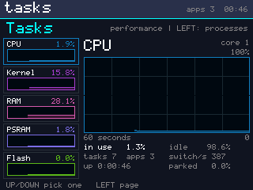 | 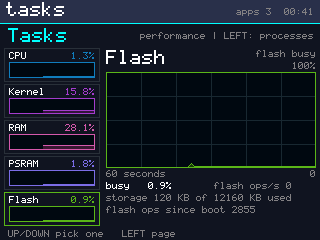 | 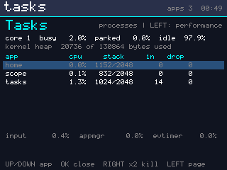 |

(Real screens, taken from the board with the new `screenshot` command, with
scope open in the background; retaken after 5.3c split Memory into three. The graphs sit low because the system is
nearly idle; the flash graph's blip is the system log being written.)

- **Down the left:** CPU, Memory and Flash, each with its value now and a
  small graph. UP/DOWN picks one. Nothing on this page closes or kills
  anything.
- **On the right:** the chosen one's last 60 seconds, newest at the right
  edge, with a grid every 25 % and every 10 s, as in Windows. Colours follow
  Windows too: CPU blue, memory purple, disk (here flash) green. The details
  are underneath:
  - **CPU** (core 1): in use, idle, parked; tasks and apps; context switches
    a second; uptime.
  - **Memory:** the kernel heap (what apps and task stacks are allocated
    from), its largest free block, and the free internal RAM and PSRAM.
  - **Flash:** how much of the time core 1 was parked for flash work;
    flash operations a second and since boot; storage used.

Free RAM, PSRAM and storage can only be asked of IDF, which core 1 must not
call. So a small `os/sysinfo` module has core 0's main loop ask twice a second
(storage every 10 s, since working it out reads flash), and hands core 1 a
consistent copy through a sequence number.

#### `screenshot`, and seeing the screen from the PC

The shell's new `screenshot` command sends the framebuffer as hex, one row per
line. `tools/screenshot.py shot.png [commands...]` types the commands first
(`"open tasks" "key left"`), then saves the screen as a PNG. That's how the
page above was checked by eye, and where its first layout problem was found:
the Flash page's subtitle ran into the "100%" beneath it and read "core 1
parked for 100%".

**Opening the serial port reset the board.** pyserial raises DTR and RTS as it
opens a port, and on this chip's USB port that is a reset. So every
screenshot rebooted the board, and the app it was meant to capture was gone.
`tools/shell_test.py` had never noticed, because it resets on purpose anyway.
The port now opens with both lines low. The deliberate reset then stopped
working: Windows' USB serial driver only sends an RTS change along with a DTR
write, which opening the port had been providing by accident. `reset()` now
writes DTR again after each RTS change, as esptool does.

#### Tests

`-D SMARTOS_TEST_APPS`, with a spinning app and flash writes to drive the graphs:

```
  performance page             page 1, 3 samples; cpu 99.2%, memory 66.8% (heap 66.8%), flash 84.1%;
                               px blue 1208, purple 1085 OK
  back to processes            LEFT again: page 0 OK
```

The pixel counts are the graph colours actually on the panel's framebuffer.
Test build 91 OK, 0 FAIL. Default boot 37 OK, 0 FAIL. `tools/shell_test.py`
all OK, including a new check that `screenshot` sends 240 rows of 320 pixels.

### Stage 5.3c - memory: stacks returned, a bigger pool, PSRAM for apps

The Memory graph of 5.3b showed the kernel heap 70 % full with almost nothing
open. The question was why, and how anything else would fit. Measured:

```
before:  13 ended task(s) still holding their stacks: 29952 bytes of kernel heap
         kernel heap   41536 B used of 65200 B            (Home only)
         internal RAM  231 KB free, largest block 160 KB;  PSRAM 8037 KB free
```

The heap was a 64 KB array fixed at build time. It was sized for the stage 2
demos and never revisited, while 231 KB of internal RAM and almost all of the
8 MB PSRAM sat unused. **72 % of what it held was waste:** a task can't free
the stack it's standing on, so a dead task's stack went back only when its slot
was reused, and the thirteen tasks the boot self-tests finish never had theirs
reused.

What changed, as agreed:

1. **Ended tasks' stacks go back at once.** Core 0's main loop returns a DEAD
   task's stack as soon as no core is on it (`k_free_dead_stacks`). Killed
   (ZOMBIE) tasks still wait for their mailbox slots to be cleared (5.2).
2. **The kernel's pool is 128 KB of internal RAM**, taken from ESP-IDF at
   boot.
3. **A second pool, 4 MB of PSRAM, for apps' large data**: sample buffers,
   maps, images. Apps call `app_alloc(c, bytes)` and `app_free(c, p)`. Every
   block carries its owner, so when an app ends, whether it closed or was
   killed, everything it took comes back (`kheap_free_owner`). Stacks, and
   anything the kernel touches with the flash cache off or uses for atomics,
   stay in internal RAM.
4. **The Performance page shows all three memories**: Kernel, RAM and PSRAM
   each get an entry on the left, a 60 s graph, and a composition bar like
   Windows', split into what the memory is made of. The kernel pool: task
   stacks, app state, the kernel's own, free. Internal RAM and PSRAM: the
   kernel pool's used part, its spare part, ESP-IDF (and the screen buffer),
   free. "In use" counts the kernel pools' spare room as free: it's taken from
   ESP-IDF, but holds nothing yet.

```
after:   kernel heap   11584 B used of 130928 B            (Home only)
         0 ended tasks hold stacks;  PSRAM pool 4095 KB for apps
```

| Kernel | RAM | PSRAM |
|---|---|---|
| 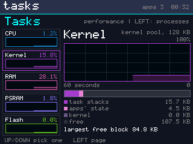 | 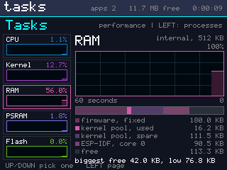 | 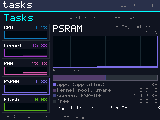 |

(Real screens from the board. The first version of the key under the bar had
two columns, and the screenshots showed their labels running into each other,
so it's one column with right-aligned sizes now.)

#### Tests

Every boot now checks the pools exactly: every byte of each region is either
a block header or a payload, and no ended task holds a stack.

```
  kernel memory                internal 11584 of 130928 B used, psram 4095 KB pool; 0 ended tasks hold stacks OK
```

`-D SMARTOS_TEST_APPS` adds an app that takes 1 MB of PSRAM, writes a pattern
through it and reads it back, then asks for 3.5 MB more, which can't fit:

```
  app PSRAM                    1 MB ok: 1, 3.5 MB refused: 1; held 1048576 B; after close 0 -> 0 B,
                               held again 1048576, after kill 0 B OK
  performance page             page 1, 3 samples; cpu 99.1%, kernel 14.1% (heap 14.1%), ram 32.4%,
                               psram 1.8%, flash 82.5%; px 1147/1315/1216/1106 OK
  nothing left behind          20 kills, 0 failed; heap 11584 -> 11584 B used; tasks 5 -> 5 ... OK
```

Test build 93 OK, 0 FAIL, twice. Regression, each its own build:
`SMARTOS_TEST_SLEEP_CLAIM` 0 second copies in 3000 sleeps; `SMARTOS_TEST_EVBUS` 4000
events to each subscriber, 0 lost, 0 out of order; `SMARTOS_TEST_MBOX_STRESS`
0 wrong in 1000 sums, mailbox empty after; `SMARTOS_TEST_APPS` + `SMARTOS_TEST_APPHOG`
95 OK, 0 FAIL. Default boot 38 OK, 0 FAIL; `tools/shell_test.py` all OK.
With the pools taken, ESP-IDF still has 166 KB of internal RAM and 3.9 MB of
PSRAM free.

#### What this stage found

**The first version reset the board on every boot.** Core 0 hung inside
FreeRTOS with interrupts masked, and the interrupt watchdog fired. The value
it was stuck on, FreeRTOS's pending-tick count, is a plain FreeRTOS variable,
so something had broken FreeRTOS's state. Bisected on the board:

| variant | result |
|---|---|
| new allocator, dead-stack return switched off | panics |
| new allocator, internal pool as a static array | panics |
| new allocator, no PSRAM pool | panics |
| **old allocator**, everything else new | **0 panics** |

The cause: `k_init`, which sets up the heap, runs on **core 1**, not core 0
as I had assumed, and the new `kheap_init` called ESP-IDF's
`heap_caps_aligned_alloc` from there. That breaks the rule this project has
kept since stage 2.5: core 1 never takes a FreeRTOS or ESP-IDF lock. Every
panicking variant still called ESP-IDF from core 1 for at least one pool; the
old allocator never called it at all. Now core 0 reserves and lays out both
pools (`kheap_reserve`) before it starts core 1, and core 1 does nothing but
use them.

**Waiting for the editor wasn't enough either.** Stage 5.3's fix for the
build failures was to wait until the VS Code PlatformIO extension had
finished its own build before starting one. During this stage's regression
runs, two CMake configures ran into the same folder again: the extension also
starts a build (`load_build_metadata`) when the build folder itself changes,
and a fresh build starts by deleting it. Now command-line builds don't share
the folder at all. They set `PLATFORMIO_BUILD_DIR=.pio/cli`, and the editor
keeps `.pio/build` to itself. The notes in platformio.ini say so.

### Stage 5.5 - minimise: apps that keep running in the background

Holding BACK closes an app. **Holding DOWN and pressing BACK** now puts it in
the background instead: it keeps running - its timers, its sensor stream, a
recording in progress - while Home comes to the front and lists it under
**Running**, where OK brings it back exactly as it was.

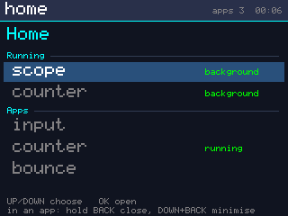

(Real screen: scope and counter both minimised.)

Because several apps can now be open at once, an app is only started if
there is room for it, and Home says so when there isn't.

#### The chord, without swallowing DOWN

A chord needs the first button held before the second arrives, and DOWN is
also an ordinary key. So a DOWN **press** is held back for `APP_CHORD_MS`
(150 ms) to see whether BACK follows:

- a **tap** is not delayed at all - its release flushes the held press
  immediately, so lists and counters feel the same as before;
- only a DOWN that is really **held** waits, and only by 150 ms;
- if BACK arrives inside the window, it's the chord: the app is minimised,
  and the rest of that gesture (the DOWN release, the BACK release) belongs to
  the gesture, not to whatever is in front afterwards.

The app manager keeps a 30 ms timer only while a press is waiting, so nothing
polls when nobody is holding anything.

**Minimised apps keep running, and each app decides what that means.** The
runtime already tells an app when it loses the screen (`SYS_FOCUS_LOST`,
`c->focused`), which is how snake pauses itself while a logger or the scope
carries on recording. Minimising uses the same path, so no app needed
changing.

#### Room to open

`app_t` gained `psram_max`: the most PSRAM that app may hold through
`app_alloc`. `app_can_start()` checks, before anything is created:

- a free app slot (`APP_MAX` is 8);
- the kernel pool can hold its stack and state, with `APP_MEM_RESERVE`
  (8 KB) left for the kernel itself;
- the PSRAM it declared is free **after** what the open apps were promised.
  An app that is running keeps its budget even if it hasn't taken it yet -
  otherwise opening a second app could leave the first unable to allocate
  what it was told it could have.

`app_alloc` holds each app to its own budget, so the promise is real. Home
shows the reason on the screen and starts nothing: "bigger: not enough PSRAM".

`min` in the shell sends the chord, for driving this without wired buttons.

#### Tests

`-D SMARTOS_TEST_APPS`:

```
  DOWN+BACK minimises          focus Home, counter still open: yes, 2 events while minimised OK
  Home switches back to it     Home selects "counter"; back in front: yes, value 2 (was 2) OK
  a tap is not delayed, a hold waits   tap: 2 -> 1 in 60 ms; held: 1 at 80 ms, 0 at 230 ms OK
  no room: refused, not started        bigger: refused (start returned -1), 2 apps open,
                                       kernel says "not enough PSRAM" OK
  room again once it closes    after bigbuf closed: OK
```

Two test apps carry the budgets: `bigbuf` declares 2 MB and takes 1 MB,
`bigger` declares 3 MB - which no longer fits beside it, and is refused
before anything starts. Test build 98 OK, 0 FAIL, twice; default boot 38 OK,
0 FAIL; `tools/shell_test.py` all OK, including a check that `min` leaves the
app running with Home in front.

#### What this stage found

**Home drew a row past the bottom of its list.** The screenshot showed the
last row sitting over the two help lines at the bottom of the screen. The
draw loop started any row whose top was above the list's end, without asking
whether the whole row fitted. It now stops at the last row that fits. Worth
noting that this was invisible to every automatic check - only the picture
showed it.

### Stage 5.4 - the launcher, finished off

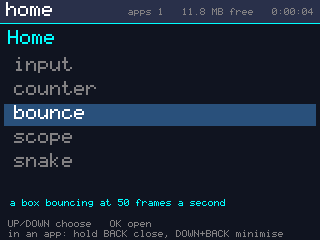

- **Every app says what it is.** `app_t` gained `about`, one line, shown under
  the list for whichever row is chosen. A test holds every registered app to
  having one, and to it fitting the screen.
- **The status bar carries the two things worth a glance from inside any app**:
  how much room is left on the filesystem, and how long the board has been up,
  beside the number of apps open.
- **Clearing the system log asks first.** OK arms it and says "OK again to
  clear the log"; any other key cancels with "not cleared". It's the only
  action here that cannot be undone.
- **The screen switches itself off** after the `screenoff` setting's seconds
  with no button pressed (60 by default, 0 means never). Apps keep running in
  the dark - a scope goes on recording - and the press that wakes it is
  swallowed, the way a phone does it.

#### Who turns the backlight on

Core 0 owns the backlight and the clock; core 1 sees the buttons first. So
core 0 decides when to switch off, and the app manager on core 1 asks it to
wake through the mailbox (`screen_wake_k`) and swallows the press that did it.

#### Tests

`-D SMARTOS_TEST_APPS`:

```
  every app says what it is    10 apps, 0 without a line, 0 too wide OK
  clearing the log asks first  "OK again to clear the log" then "not cleared";
                               log 13264 -> 13264 -> 34 bytes OK
  screen off, and the press that wakes it   off after 1967 ms (duty 0), woke to duty 1023;
                               counter 0 -> 0 -> 1 OK
  0 means never                screenoff = 0: 0 switch-offs in 2.5 s idle OK
```

The log check proves the first OK really does nothing: the log is the same
size after it, and only shrinks after the second. The screen check reads the
PWM duty on both sides, and the counter shows the waking press was swallowed -
it moves on the next press, not that one. Test build 102 OK, 0 FAIL; default
boot 38 OK, 0 FAIL; `tools/shell_test.py` all OK.

#### What this stage found

**The press that woke the screen also reached the app.** The counter went up
by one when the press was only meant to light the screen. Core 0 watches the
buttons to know when the board was last used, and it was waking the screen
itself; by the time the app manager on core 1 looked, the screen was no longer
off, so it passed that press on as an ordinary one. Now core 0's watching only
restarts the idle clock. Waking happens on core 1's request, and core 1 is
then the one that swallows the press. The check reads the counter either side:
`counter 0 -> 0 -> 1`.

### Stage 5.4b - the tests move out of main.cpp

main.cpp had reached 3,907 lines. About two thirds of it was test script: the
boot sequence and everything this firmware claims about itself, interleaved.
Adding a check meant scrolling past the kernel's demo tasks to find the right
`#ifdef`, which is how a file stops being read at all.

The suites now live in `src/tests/`, one file per area, and main.cpp is the
boot sequence again:

| file | lines | what it holds |
| --- | --- | --- |
| `src/main.cpp` | 1,696 | boot, core 1's demo and kernel-test tasks, the system loop |
| `tests/harness.h/.cpp` | 139 | what every suite shares: `sdk_case`, `pump`, `press`/`tap`, `wait_gone`, `count_colour`, `log_has` |
| `tests/tests.h` | 37 | every suite's entry point, in one place |
| `tests/test_input.cpp` | 195 | the debouncer, fed a script (3.6) |
| `tests/test_evbus.cpp` | 129 | the event bus's rules (4.2a) |
| `tests/test_gfx.cpp` | 478 | damage tracking, one transaction per rectangle, the font (3.3-3.5) |
| `tests/test_sdk.cpp` | 226 | the app SDK, by script and live (4.3c) |
| `tests/test_apps.cpp` | 234 | the app model, the launcher, the hog (4.3b) |
| `tests/test_fs.cpp` | 118 | files from an app on core 1 (4.4) |
| `tests/test_sys.cpp` | 973 | settings and the log, kill, the task manager, minimise, 5.4 (4.5-5.5) |

Two things were needed to make the cut possible at all. `src/system.h`
publishes the only two things a test wants from the boot file - `system_pass()`,
one turn of core 0's loop, and `system_fb()`, the panel to count pixels in - so
no test reaches into main.cpp's statics any more. And the files that open apps
put their whole body inside `#ifdef SMARTOS_TEST_APPS`, so a normal build compiles
them to nothing: the default firmware is 379,977 bytes of flash, the same
figure as before the move.

#### What this stage found

**`-D SMARTOS_TEST_APPHOG` stopped implying `-D SMARTOS_TEST_APPS`.** The line that made
one mean the other sat at the top of main.cpp, where it had always been enough.
Once the suites were their own translation units they never saw it, so the app
build's files compiled empty and the link failed on seven undefined suites. It
lives in `tests/tests.h` now, which every test file includes first. Worth
keeping in mind for any flag that two files have to agree on.

**A check on the CPU graph was reading whichever second it landed in.** The
app-test run failed once on `performance page` with `cpu 86.9%` where it wanted
95%, then passed on a re-run of the same firmware. Nothing to do with the move:
a flash write parks core 1 for as long as it takes, and that time belongs to
nobody - if a log flush lands in the sampled second, the spinning app cannot
have all of it. The check now takes the best second out of up to six, so what
it claims is what was always meant: a second with the spin app and no flash in
it is a second entirely its own. Re-run: `cpu 99.9%`.

#### Tests

Nothing about what is checked changed, which is the point - the same suites,
the same numbers:

```
default boot          38 OK, 0 FAIL      (flash 379,977 B, unchanged)
-D SMARTOS_TEST_APPS      102 OK, 0 FAIL
-D SMARTOS_TEST_APPHOG    104 OK, 0 FAIL      bounce 49 -> 51 frames/s with the hog,
                                         sampler 490 -> 501 passes/s
-D SMARTOS_TEST_SLEEP_CLAIM                   builds (a kernel-test build compiles
                                         the suites the same way a default one does)
tools/shell_test.py   all OK
```

### Stage 5.4c - one toolkit for the apps' screens

Four apps had grown their own copy of the same three things, and the copies had
drifted:

| | Home | Settings | Tasks | Log |
| --- | --- | --- | --- | --- |
| a list with UP/DOWN | scrolls, skips headers | `% ROWS` | `% n`, no scrolling | window over the lines |
| a value bar | - | its own | its own, multi-part | - |
| "press it again" | - | `bool confirm` | `int armed` | - |

The bug stage 5.4 found - a row drawn past the bottom of the list - existed
only in Home's copy, and there was no way to tell whether the others had it
too, because none of them was the same code.

[src/ui/ui.h](src/ui/ui.h) is that code, once: `ui_list_move` (wrap, skip the
rows that cannot be chosen, scroll only as far as it must), `ui_list_begin` /
`ui_list_next` (walk the rows that fit - a row that would cross the bottom is
not drawn at all), `ui_scroll`, `ui_row_bg`, `ui_title`, `ui_help`, `ui_bar`
and `ui_confirm`. It is not a widget tree and not a theme: the apps still draw
their own screens, and the task manager's graphs and composition bars are
still its own.

#### What it did and did not save

The four apps are within a few lines of where they started - Home lost 14
lines, Settings gained 5, Tasks 16, the log 1 - and the toolkit itself is 266
lines with its comments. So this is not a saving in lines. What changed is
that the list logic exists once, with a test of its own, instead of four
versions of which three were never checked.

#### Tests

Seven new cases on every boot ([src/tests/test_ui.cpp](src/tests/test_ui.cpp)),
because these rules are now everyone's:

```
  headers are skipped          step 0 -> 1, DOWN -> 2 (2 is a header's neighbour) OK
  the ends wrap                DOWN from 8 -> 1, UP from 1 -> 8               OK
  scrolls to the chosen row    top 3, 6 rows drawn, last ends at 100 of 100   OK
  a row that half fits is not drawn 2 of 4 rows of 20 in a box of 50, bottom 40 OK
  scrolling clamps             UP at the top 0, 20 x DOWN over 30 lines -> 11 OK
  the bar clamps               200% 500 px, 50% 250 px, -5% 0 px              OK
  two presses, same subject    "RIGHT again to kill spin", other 0, second 1, cancel 0 OK
```

And because a refactor of drawing code should change no pixels, every screen
was photographed through `tools/screenshot.py` before and after and compared
pixel by pixel. Home: **not one pixel** different in the app area. Settings:
24 pixels, all of them the boot number (#438 -> #440). Tasks and Performance:
only the live figures - a percentage, a byte count. The app build came through
the move with the 102 cases it had, unchanged, and the boot with its 38 - then
these seven joined both, making 45 and 109.

### Stage 5.4d - the limits, on purpose

Every one of these was a number in a header with nothing that ever reached it,
so what happened at the limit was a guess.

| limit | what it is | what happens now |
| --- | --- | --- |
| the stack | `K_STACK_SIZE`, 2 KB for every app | an app names its own in `app_t.stack` |
| the timers | `EVBUS_MAX_TIMERS`, 8 for the system | refused, logged with the app's name, counted |
| the bus | `EVBUS_MAX_SUBS`, 12 slots | `app_can_start` says "no room on the event bus" |
| the pool | 128 KB of internal RAM | refused before anything is created |
| the disk | 12 MB of LittleFS | `FS_ERR_FULL`, and the log says what it lost |

**A stack per app.** `k_task_create_stack` takes the size, rounds it to 16
bytes and holds it to `K_STACK_MIN`..`K_STACK_MAX` (1 KB..16 KB);
`k_stack_bytes_for` is that same arithmetic, public, so admission can ask for
the true figure before finding the memory. `app_t.stack` is 0 for every app
here, which still means 2 KB - what changed is that an app *can* say
otherwise, and that the task manager's stack column is now a real figure
against a real size rather than against a constant.

**A refusal an app can hear.** `app_timer` used to hand back a bare -1. An app
that did not check simply never ticked again, with nothing anywhere to say
why. It now writes the refusal to the system log with the app's name and
counts it (`app_timers_denied`).

**The log, on a disk with no room.** `slog_flush` dropped a batch it could not
write and said nothing. It still drops it - holding it would grow RAM without
end while the disk stays full - but the console is told the first time and
again when writing works, and `slog_lost_batches` / `slog_lost_bytes` count
what went missing.

#### Tests

`-D SMARTOS_TEST_APPS`:

```
  an app picks its stack       asked 1024, got 1024, 624 used, 3 frames deep  OK
  2 KB unless it says otherwise counter: 2048 bytes; the kernel's own floor 1024, ceiling 16384 OK
  more timers than there are   asked 12, got 7, refused 5; 56 ticks after, alive 1 OK
  state past what one app may take  256 KB of state: "asks for too much kernel
                               memory", start -1, apps 0 -> 0, pool 13888 -> 11584 OK
  the bus runs out of slots    8 slots taken: "no room on the event bus", start -1;
                               free again 8, then "OK"                        OK
```

Seven of eight timers, not eight: one was already the status bar's clock.

`-D SMARTOS_TEST_FSFULL` (its own build - it writes about 11 MB and takes four
minutes):

```
  writing until it is full     10672 KB in 333 files, then -4 (full);
                               one byte more: 0 (still fits); 273 s all in    OK
  the log survives a full disk 0 batches lost (0 bytes), 2 writes since; log 987 bytes OK
  deleting gives it back       80 KB used of 12160 KB, was 2860 KB before the fill OK
```

#### What this stage found

**A byte still fits where 8 KB does not.** After LittleFS refused an 8 KB
append with `ENOSPC`, a one-byte `fs_write` succeeded. That is how the
allocator works, and the test now claims what is true - the error comes back
and nothing crashes - rather than that the filesystem is unusable from then
on.

**The log did not lose a line on a full disk.** The expectation was that it
would, and the first version of the test insisted on it. It does not, because
the log rotates: `log.txt` becomes `log.1.txt`, which frees a whole file's
worth of blocks. The counters stay for the case where it cannot - no mount, or
a disk full of files nobody rotates.

**Two bugs, both in the tests, both found on hardware.** The first run read the
filler app's results while the app was still working, so "one byte more" came
back as the sentinel 99 and the disk looked like it had 2.8 MB left in it; the
script now waits for a flag the app sets last. That run then left 2.8 MB of
its files behind, which the next run appended to - so the filler removes
anything an earlier run left before it starts, the way `app_fstest` does. And
the tiny-stack app recorded its depth while unwinding, so it always read 0.

### Stage 5.4e - what the board stops doing

**A frame drawn in the dark is not sent.** The backlight goes off after the
`screenoff` seconds and the apps keep running - which is the point - but every
frame they drew was still being pushed down the SPI bus to a panel nobody can
see. The compositor now takes the frame and acknowledges it, so the app never
stalls waiting for `SYS_FRAME_DONE`, and sends nothing. The damage tracker
keeps what was drawn meanwhile, and the first flush after the screen comes
back sends the whole area, so the panel cannot be left showing a stale frame.

**A ceiling for one app.** `APP_KERNEL_MAX` is 32 KB: a stack and a state
block, per app, out of the 128 KB pool. Before this, "does it fit" depended on
what else happened to be open - the same app could start on a quiet board and
be refused on a busy one - and one careless app could leave the pool with
nothing for the next. The ceiling is checked first, so an app that is simply
too big is told so either way.

#### Tests

`-D SMARTOS_TEST_APPS`, with bounce drawing 50 frames a second:

```
  no frames while the screen is off  dark: 51 frames taken, 0 sent, 0 px;
                                     awake: 35074 px (70148 B) a second       OK
  a ceiling for one app              hungry: "asks for too much kernel memory"
                                     with 119344 B free; biggest real app log
                                     at 5580 B of 32768                        OK
```

70 KB a second of SPI traffic, and the CPU time to stage it, for a screen that
is off. The second case also holds every registered app to the ceiling: the
largest today is the log viewer at 5,580 bytes, a sixth of it.

#### Where 5.4c to 5.4e leave the board

Every build, re-run after all three:

```
default boot          45 OK, 0 FAIL      (38 + the toolkit's 7)
-D SMARTOS_TEST_APPS      116 OK, 0 FAIL
-D SMARTOS_TEST_APPHOG    118 OK, 0 FAIL      bounce 49 -> 51 frames/s with the hog,
                                         sampler 482 -> 500 passes/s
-D SMARTOS_TEST_FSFULL    117 OK, 0 FAIL      (4.5 minutes of it filling the disk)
-D SMARTOS_TEST_SLEEP_CLAIM  42 OK, 0 FAIL    3000 sleeps, 0 times a second copy ran
-D SMARTOS_TEST_EVBUS        46 OK, 0 FAIL    20 ms timer late by 0-3 ms
-D SMARTOS_TEST_MBOX_STRESS  42 OK, 0 FAIL    1000 sums, 0 wrong; mailbox empty after
tools/shell_test.py   all OK
```

The kernel regressions matter here because 5.4d changed `k_task_create_gen` -
every task's stack now comes from `k_task_create_stack` - and the sleep-claim
and mailbox tests are the ones that would notice.

## Stage 6 - how the system looks

Everything up to here was about what the board does. This stage is about what
it looks like while doing it.

### Stage 6.1 - a boot screen

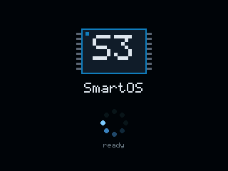

A boot used to look like what it was. The panel came up, the benchmark ran,
the graphics self-tests painted swatches, damage rectangles and a full sheet of
glyphs across the screen, and then Home appeared. Every one of those is a
measurement this firmware makes on every boot and is not going to stop making -
but nobody needs to watch it happen.

So the backlight now stays down from panel bring-up until the boot screen.
The tests still draw, still flush, over the same SPI at the same cost, in the
dark. Then [src/os/boot.cpp](src/os/boot.cpp) paints one screen - a mark, the
name, a spinner, and a line saying what is coming up - and fades the backlight
in over 160 ms. The mark is drawn, not an image: a chip with its pins and "S3"
across it, in the framebuffer's own primitives. Stage 6.2 brings real images
in, and this is the first thing that should be able to use one.

**The spinner turns on its own.** It has to: boot is not a loop, it is a
sequence of long synchronous steps, and a spinner that only moved when a step
finished turned nine times in two seconds and looked broken. It now turns every
90 ms from an `esp_timer` task on core 0, whatever core 0's main task is doing.
It does stall during a flash write - the cache is off and nothing else on the
core runs at all - and that pause is honest: it is the filesystem, and it is
short.

**It is held for 1.5 seconds** (`BOOT_MIN_MS`), the only place in this
firmware where time is spent on purpose. A boot screen nobody sees is not a
boot screen. The whole boot to Home is about 8 seconds, most of it the
self-tests, so the hold usually costs nothing at all: by the time the last step
runs, the screen has already been up for over two.

**`bootscreen` in the shell** paints it again over whatever is on the panel, so
it can be looked at - and screenshotted - without rebooting. While a preview is
up the status bar keeps off the panel, or the clock would repaint over the top
of the picture a second later and a screenshot of the boot screen would not be
one. The picture above was taken exactly that way.

#### Tests

One new case on every boot:

```
--- stage 6.1: the boot screen ---
  boot screen    up 2197 ms, 8 steps, 23 frames, 633 px of the mark at the end, duty 1023 OK
```

The last two figures are the ones that matter. "633 px of the mark at the end"
counts the mark's own blue in the framebuffer at the moment the boot screen
hands the panel over - it answers the question a screenshot cannot: was the
mark still there when the launcher took over, or had something drawn over it?
And the duty proves the backlight really did come up.

Default boot 46 OK, 0 FAIL; `-D SMARTOS_TEST_APPS` 117 OK, 0 FAIL;
`tools/shell_test.py` all OK, including the new command.

#### What this stage found

**Two different things were wiping the mark, and the same check caught both.**
The first version of the boot test read `0 px of the mark at the end`.

- `system_loop` cleared the screen and drew the status bar *before* holding the
  boot screen, so the last second of every boot was a spinner floating on an
  empty status bar. The hold now happens first, and the bar is drawn onto the
  panel the boot screen has already given up.
- `sdk_logic_test` draws lines and circles and counts the pixels - and it was
  doing it in the panel's own framebuffer, clearing it to black four times on
  the way. It never flushes any of that, so it never needed the panel: it has
  its own 320x240 buffer now, taken and given back around the test.

Neither was visible in a screenshot, because a screenshot is taken long after
boot is over. A number measured at the moment it matters found both in one run.

### Stage 6.2 - a picture behind Home

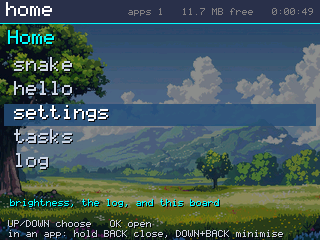

The picture is the user's, kept at [docs/art/wallpaper_src.jpg](docs/art/wallpaper_src.jpg) so the
wallpaper can always be made again. Putting another one in is one command:

```
python tools/mkimage.py my_photo.jpg src/gfx/wallpaper_data.cpp --dim 55
```

and a rebuild - a 5824x3264 photograph goes in, 320x216 comes out. The
`wallpaper` setting (0 or 1) turns it off without one.

#### No decoder on the board

A JPEG or PNG decoder is code, working memory and time on every draw, for a
picture that only changes when the firmware does. So the picture is prepared on
a computer - [tools/mkimage.py](tools/mkimage.py) scales it until it covers
Home's 320x216 area, centres and crops it (never squashes), dims it, and
converts it to RGB565 **already byte-swapped into the panel's wire order** (see
the note at the top of [src/gfx/fb.h](src/gfx/fb.h)). What reaches the firmware
is an array that can be copied straight into the framebuffer: no decoding, no
conversion, no allocation, and not one byte of RAM - it is read out of flash as
it is drawn.

The dimming is on that computer too, and it is not a detail. White text over a
photograph at full brightness is unreadable; at 55% the text wins and the
picture is still a picture. Doing it here costs the board nothing at run time.

#### Drawing over a picture

A flat background made "put the background back" a fill of one colour.
Everything in [src/ui/ui.h](src/ui/ui.h) that paints an area now takes a
picture or null, so an app with a background and an app without run the same
code:

- `ui_clear(fb, bg, x, y, w, h)` - the picture's own pixels from the same
  place, or the flat colour.
- `ui_row_bg(fb, bg, y, h, selected)` - and the chosen row is **blended** over
  the picture rather than painted over it (`fb_blend_rect`, 70%), so the
  wallpaper still shows through the highlight. Over a flat background it is
  the solid fill it always was, pixel for pixel.

Settings and the task manager pass null and are unchanged.

#### Text on a photograph

The first real picture made this obvious in a way the placeholder never could:
**grey names over a bright sky cannot be read at all.** The placeholder was
dark, so everything Home drew stood out against it; a photograph has bright
parts and dark parts, and the same grey is fine on one and invisible on the
other.

Dimming the picture far enough to fix that makes the picture not worth having.
What works instead, and works whatever the next picture turns out to be:

- **every line gets a shadow** - `ui_text(..., shadow)` draws the string once
  in near-black one pixel down and right, then in its own colour. It costs one
  extra pass of the same text and gives every glyph an edge.
- **the greys are lifted** over a picture: an unselected name goes from
  `FB_GREY` to near-white, the help lines from grey to a light grey.
- **the selected row blends at 85%**, not 70%. Over the dark placeholder 70%
  was plainly a highlight; over a bright sky it was a faint tint.

With the wallpaper off, Home draws exactly what it drew before - no shadows,
the old greys, a solid highlight.

#### What it costs

```
  Home shows the picture       320x216 in flash (138240 B); 58244 of 69120 px on the panel are the picture OK
  the setting turns it off     picture pixels 58244 -> 67; flat background 59845 of 69120 px OK
  and on again                 back on: 58244 px of the picture (was 58244)   OK
  what the background costs    whole picture 9208 us (15 MB/s from flash), one row blended 859 us OK
```

- **138 KB of flash**, 0 bytes of RAM. The firmware went from 390 KB to 529 KB,
  12.6% of the 4 MB partition.
- **9.2 ms** to paint the whole background, which is the flash cache's read
  speed and happens only on a full redraw - gaining focus, or the setting
  changing. Moving a row redraws two rows and the line under the list, not the
  picture. For scale, the flush that puts that frame on the panel is 15.4 ms.
- **859 us** to blend a selected row.

The first check is exact rather than approximate: the picture is 320x216 and
the app area is 320x216, so every pixel of it has exactly one place it can be
on the screen. 58,244 of 69,120 are the picture where the picture should be;
the other 16% is what Home draws on top - rows, names, the description line,
and now their shadows. Turned off, that count falls to 67 (pixels that happen
to match by colour) and the flat background takes 59,845.

Default boot 46 OK, 0 FAIL; `-D SMARTOS_TEST_APPS` 121 OK, 0 FAIL.

### Stage 6.3 - the radio

There is one radio in an ESP32-S3 and it is 2.4 GHz. Everything below was read
off the chip and measured on the air rather than copied out of a datasheet:

```
s3> wifi
  ESP32-S3 rev 0.2, 2 core(s)
  2.4 GHz Wi-Fi b/g/n: yes      5 GHz: no, not on this chip
  Bluetooth LE: yes   classic: no   802.15.4: no
  MAC  wifi 3c:dc:75:xx:xx:xx  ap 3c:dc:75:xx:xx:xy  bt 3c:dc:75:xx:xx:xz
  radio up: country TH , channels 1..13 (2412..2472 MHz), max TX 20.0 dBm
```

Wi-Fi and Bluetooth LE share that one radio and that one antenna. There is no
5 GHz band, no sub-GHz and no 802.15.4 on this part: a board that needs any of
those needs a second chip beside this one.

**Which channels may be used is a matter of law, not of radio.** The driver
enforces a country's plan, and IDF's default is the world-safe `01`, which
stops at channel 11 - so two channels this board is allowed to use at home
would never even be scanned. It is set to `TH` now (1..13, 2412-2472 MHz) and
`wifi country JP` would add channel 14 at 2484 MHz. Nothing in the radio
changes; what changes is what the driver will let it do.

**The radio is not started at boot.** It costs internal RAM and a launcher does
not need it, so `wifi up` starts it - the same way an app only runs when
someone opens it.

#### What is actually on the air

```
s3> wifi scan
  10 access point(s) in 2500 ms
  ch   MHz  rssi  auth    bssid              ssid
  --  ----  ----  ------  -----------------  ------------------------
   6  2437   -69  WPA2    ...                (hidden)
   6  2437   -70  open    ...                network-01
  11  2462   -83  open    ...                network-01
   1  2412   -87  WPA     ...                network-04
  ...
  per channel (country TH , channels 1..13):
    1  2412 MHz  4 ap(s), strongest -87 dBm
    6  2437 MHz  3 ap(s), strongest -69 dBm
   11  2462 MHz  3 ap(s), strongest -83 dBm
```

Channels 1, 6 and 11 and nothing else, which is what a 2.4 GHz band looks like
anywhere people have configured their routers properly: those three are the
only ones that do not overlap.

#### Comparing antennas

One scan is not a measurement - the same access point moves several dB between
scans and a weak one drops out of half of them. So
[tools/wifi_survey.py](tools/wifi_survey.py) takes five scans, keeps every
access point by its **BSSID** (its radio's own address, the only thing that is
the same one from scan to scan), and reports the median:

```
python tools/wifi_survey.py without.json      # antenna off
python tools/wifi_survey.py with.json         # antenna on
python tools/wifi_survey.py without.json with.json
```

The last one prints the same BSSIDs side by side with the change in dB, and
lists the access points that appeared in only one of the two - appearing at all
is itself a result. +3 dB is twice the power.

The surveys kept in [docs/radio/](docs/radio/) are the real measurements with
the identifiers taken out: every access point is numbered in the order it was
first seen, the same number in every file, so the comparisons still run - but
the neighbours' routers are not published along with them.

This matters because of what the module is: an **ESP32-S3-WROOM-1** has a
printed antenna and no connector, while a **-1U** has the U.FL connector and
*no printed antenna at all*. On a -1U with nothing screwed on, the radio is
working into a few millimetres of circuit board.

#### Which antenna this board uses: the printed one

The module is a generic `S3-N16R8` (WiFi+BT, 2.4 GHz) with a U.FL connector and
a pigtail to a 10 cm rubber-duck antenna - the right length for 2.4 GHz. So the
external antenna was measured against no external antenna, five scans each:

| | no external antenna | with it | after removing it again |
| --- | --- | --- | --- |
| access points seen | 14 | 10 | 6 |
| strongest | **-57 dBm** | -64 dBm | -58 dBm |
| detections over 5 scans | 42 | 27 | 16 |
| median change, same BSSIDs | - | **-4 dB** | **+0 dB** vs the first, **+5 dB** vs with |

Attaching the antenna made every single access point weaker - not one improved
beyond noise - and four dropped out of range entirely. Removing it put the
numbers back where they started. **A second pair of surveys, run separately
and later** (`*_run2.json` in [docs/radio/](docs/radio/)), came out the same
way: strongest -58 dBm without the antenna against -65 dBm with it, and all
four access points seen in both were 7 to 8 dB worse with it attached. (The count of access points moves with the
hour: the weak ones at -86 to -92 dBm sit on the detection floor and drift in
and out. What is stable, and what the comparison is made on, is the same BSSID
measured twice.)

-57 dBm with nothing attached is a **strong** signal, and that is the real
finding: this board has a working printed antenna, and the radio was already
using it. Why the external one was worse was not established - the photograph
shows it lying across the module and held in a hand while the first survey ran,
which is worth several dB on its own, and these modules commonly have a 0-ohm
link that leaves the printed antenna selected whatever is plugged into the
socket. Either way the decision is made on the measurement: **the board uses
its printed antenna**, the pigtail comes off, and
[docs/radio/](docs/radio/) keeps all three surveys so the next antenna has
something to be judged against.

#### What this stage found

**Linking the radio in stopped the kernel getting its memory.** The first build
with Wi-Fi compiled in did not boot:

```
[core0] !! could not reserve the kernel's memory pools
[kernel] no memory for a 2048 byte stack      (eighteen times)
Guru Meditation Error: Core 0 panic'ed (LoadProhibited)
```

`kheap_reserve` asked ESP-IDF for one contiguous 128 KB block of internal RAM
and, when the Wi-Fi stack's own memory had taken the heap below that, got
nothing - and a kernel with no pool has no task stacks, so nothing ran at all.
It had been all-or-nothing since stage 5.3c, which was fine while nothing else
competed for internal RAM.

Two changes, and both were needed:

- **The buffers go to PSRAM.** `CONFIG_SPIRAM_TRY_ALLOCATE_WIFI_LWIP=y` puts
  Wi-Fi's and lwIP's buffers in the eight megabytes that were doing nothing,
  and the static pools are smaller than IDF's defaults (6 static RX buffers,
  16 dynamic each way) because this board scans and fetches - it is not a
  router.
- **The reservation settles.** It asks for `KHEAP_INTERNAL_SIZE`, and if that
  cannot be had it takes the largest block available less `KHEAP_IDF_RESERVE`
  (40 KB, because ESP-IDF still has to run the filesystem, the USB console and
  Wi-Fi itself), down to a floor of 48 KB. What it got is printed at boot and
  is what `kheap_stats` reports:

```
[core0] kernel pools: 128 KB internal (asked 128), 4096 KB PSRAM     <- normal firmware
[core0] kernel pools:  68 KB internal (asked 128), 4096 KB PSRAM     <- the app-test build
```

The test build carries about 60 KB of static test buffers of its own, so it is
the one that has to settle; the firmware people actually run still gets all of
it. The boot check was tightened to match: it used to demand exactly 128 KB,
and now demands that the arithmetic adds up, that what was given is between the
floor and the full size, and that what is in use leaves room to work.

#### Tests

Six new cases in `-D SMARTOS_TEST_APPS`. None of them depends on what happens to be
on the air - that is what the survey tool is for:

```
  one radio, 2.4 GHz only      ESP32-S3 rev 0.2: 2.4 GHz yes, 5 GHz no, BLE yes, 802.15.4 no OK
  channels to frequencies      ch1 2412, ch6 2437, ch13 2472, ch14 2484 MHz   OK
  the radio starts             up, 59784 bytes of internal RAM, 51 KB free after OK
  the channel plan             country TH , channels 1..13 (2412..2472 MHz), max TX 20.0 dBm OK
  a scan of the band           5 access point(s) in 2500 ms, 0 outside the plan, strongest -66 dBm OK
  and gives it back            109 KB free before, 100 KB after; 9840 bytes not returned OK
```

The last one is honest about what does not come back: the network interface and
the event loop are created once per boot and never undone, which is 9,840 bytes
of the 59,784 the radio took.

Default boot 46 OK, 0 FAIL (the radio is not started, and the kernel still gets
its full 128 KB); `-D SMARTOS_TEST_APPS` 127 OK, 0 FAIL; `tools/shell_test.py` all
OK. Firmware 529 KB -> 1,110 KB of the 4 MB partition: the Wi-Fi stack is 580 KB
of code whether it is started or not.

### Stage 6.4a - a keyboard for six buttons

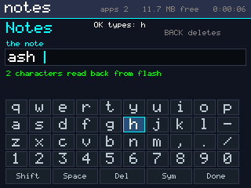

Everything typed into this board so far came from a computer, down the USB
cable, through the shell. The board itself had no way to spell a word: six
buttons, and nothing that turned them into letters.

[src/ui/keyboard.h](src/ui/keyboard.h) is the usual answer - a grid with a
cursor on it - built for the buttons that exist:

| | |
| --- | --- |
| UP DOWN LEFT RIGHT | move, wrapping at every edge; **held, they repeat**, so crossing the grid is one long press |
| OK | type the key under the cursor - a held OK does *not* repeat, or one letter would fill the line |
| BACK, tapped | delete the character before the caret |

**BACK is a tap on purpose.** Holding it closes the app, which is the system's
rule everywhere and not one a keyboard gets to break - so there is a `Del` key
on the grid as well, for anyone who would rather not risk the hold.

Four rows of ten characters, then five wide keys - Shift, Space, Del, Sym,
Done - each two grid columns wide, so up and down still line up with the
letters above them. Shift turns the letters into capitals and the digit row
into `!@#$%^&*()`, the way a real keyboard does; Sym is a second page of
brackets, quotes and arithmetic.

**The screen says what OK will do.** A grid of small keys does not tell you
which one the cursor is on if you are reading it from across a room, and that
is the one thing someone about to press OK wants to know - so the header line
spells it out: `OK types: h`.

#### Something to type into

[src/apps/app_notes.cpp](src/apps/app_notes.cpp) is the first thing on this
board that can be typed into with nothing plugged in. One line, kept in the
app's own folder at `/fs/apps/notes/note`, written whole by `fs_write` - which
replaces atomically, so a note is never half old and half new - and read back
when the app opens. That read-back is also the proof: the line on the screen
after reopening came off the flash, through `fs_read`, from core 1.

#### Tests

Five cases on every boot, driving the keyboard exactly as an app does - a
button mask and an event kind:

```
  it types what it points at   starts on 'a', typed "as"                      OK
  held arrows move, held OK does not column 1 -> 3 on two repeats; text still "as" OK
  the edges wrap               LEFT from column 0 -> 9, UP twice from row 1 -> 4 OK
  shift                        three downs land on "Shift"; then typed "A"    OK
  delete, and a line that is full BACK emptied it: yes; 64 typed of 72, full flag 1 OK
```

and two in `-D SMARTOS_TEST_APPS` that go the whole way - grid, line, Done, flash,
and back:

```
  typed on the board, kept on flash  opened "no note yet - type one"; typed "as",
                                     said "saved 2 characters (1 time)"; on flash: yes OK
  and it is there next time          reopened: "as" (2 characters read back from flash) OK
```

The note file is deleted before that test starts, so what is found afterwards
cannot be a leftover from an earlier run.

Default boot 51 OK, 0 FAIL; `-D SMARTOS_TEST_APPS` 134 OK, 0 FAIL;
`tools/shell_test.py` all OK.

#### What this stage found

**A burst of DOWNs from the shell is not four presses.** Typing on the board
by hand worked immediately; driving it from `key down down down` did not, and
the cursor kept landing somewhere other than where the arithmetic said. The
reason is stage 5.5: a DOWN press is **held back `APP_CHORD_MS`** to see
whether BACK follows it, and its release flushes it - so four DOWNs sent
microseconds apart are not four presses arriving, they are a chord being
disentangled. A finger cannot do that; a shell can. The scripted test paces its
taps and pumps between them, and the app's `OK types:` line means the cursor no
longer has to be guessed at from the outside.

**A sensor reading lost to a flash write is not a fault.** The scope test -
which has been asserting `dropped == 0` since stage 4.4 - failed once in this
stage's runs with `lost 0+3` and `flash busy 218 ms`. That is arithmetic, not a
bug: the app reads one sample every 10 ms and its queue holds 16, so a park
longer than 160 ms must cost it events. The claim now matches what the system
actually promises - every reading the sampler took reached the app, and every
one the app lost is covered by the time core 1 was parked - which is the same
rule the event bus's timer test has used since stage 4.2 for lateness.

## Measurements from stage 1

| | value |
|---|---|
| PSRAM | 8,386,279 bytes |
| framebuffer (320x240 RGB565) | 153,600 bytes, 1.8% of PSRAM |
| SPI 80 MHz | 20.09 ms/frame -> 49.8 FPS, 7.65 MB/s |
| fixed cost per SPI transaction | 14.6 us |

Measured first on a 3.5" ILI9488, which forced 18-bit colour over SPI - three
bytes per pixel, 460,800 per frame, a 19 FPS ceiling. The 2.4" ST7789V takes
RGB565 directly, so a frame is 153,600 bytes and the ceiling is 49.8 FPS.

Full-screen redraws are still not affordable at frame rate, which is what
forces the dirty-rectangle compositor in stage 3. The per-transaction cost
matters more now, not less: a 320-pixel row is only 640 bytes, so 14.6 us of
fixed overhead per transfer is a larger share of it than it was at 1440. Small
rectangles have to go out as one transfer, not row by row.

## Bringing it up

First run with a board attached should print, in order:

```
core 1    : asleep, never started by IDF
[core1] alive
[core1] bringing up the kernel
[kernel] tick armed: 1000 Hz, 240000 cycles, CPU int 6 (CCOMPARE0)
[alpha] i=0 ...          <- context switch works
[deep] round 0: yielded from 6 frames deep, all intact
[ticker] tick=... ms=...  <- the tick interrupt works
[kheap] .../49136 bytes used ...
[core1 via core0] printed with a real printf, by the other core
```

If it stops before `[core1] alive`, the wake sequence in
[kernel/kcore1.cpp](components/smartos/port/kcore1.cpp) is where to look. If it stops later,
core 1 has faulted and core 0 prints a decoded report - to check that path
itself works, build with `-D SMARTOS_TEST_CORE1_FAULT`.
